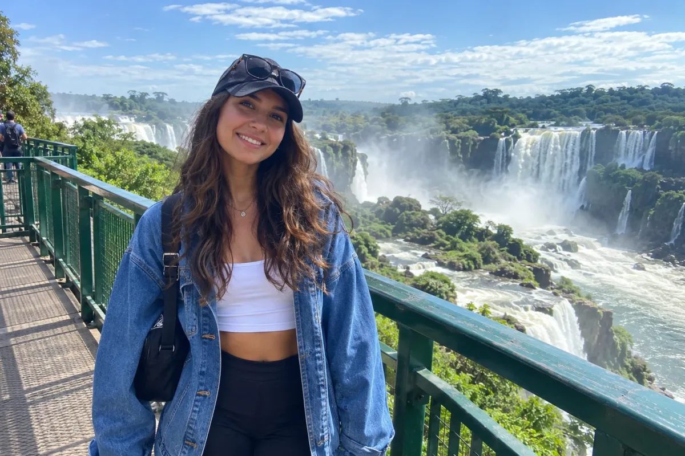
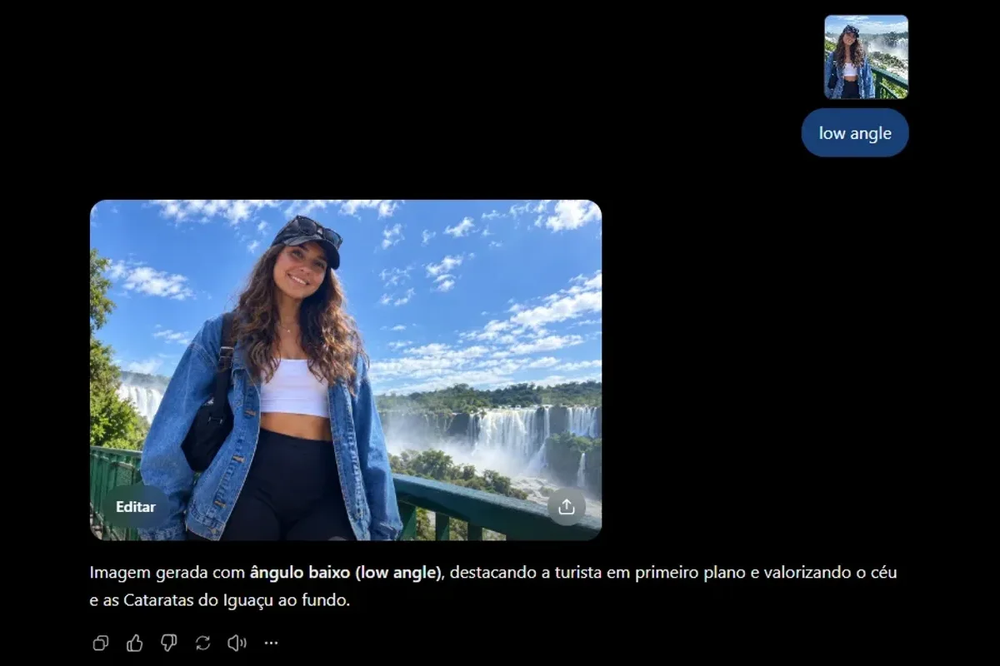
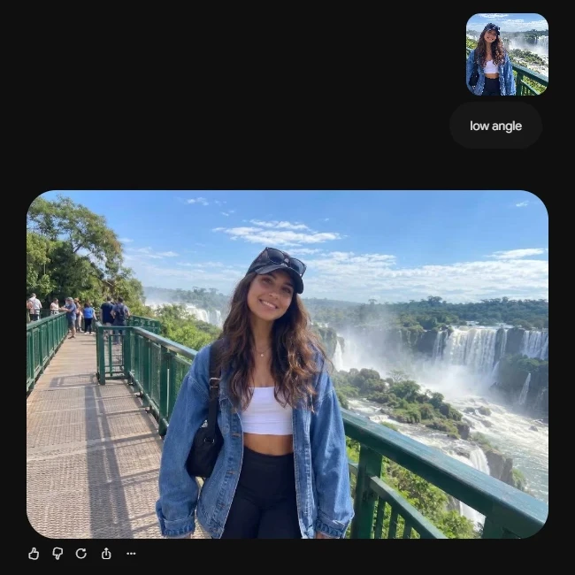

Dá para pegar uma foto sua, enviar para uma IA e pedir que ela apareça como se tivesse sido tirada de outro ângulo: de baixo para cima, de cima para baixo, de drone. Basta **enviar a foto e escrever um comando de ângulo**, como `low angle` ou `high angle`. Este guia mostra qual IA usar, o passo a passo e os textos prontos para copiar. Se você prefere atalhos com barra, como `/lowangle`, veja os [46 comandos do ChatGPT para imagens](/46-comandos-do-chatgpt/); para câmera em foto e vídeo do Google, os [40 comandos de câmera do Flow](/comandos-camera-google-flow/).

Duas coisas para ter em mente desde já. A IA não "gira a câmera" da foto original: ela **desenha uma nova imagem** parecida com a sua, vista de outro lugar. Por isso o rosto, as roupas e o fundo podem mudar um pouco, e às vezes é preciso tentar duas ou três vezes. Além disso, os textos deste artigo são sugestões minhas, escritas a partir de guias publicados. Testei o comando `low angle` no ChatGPT e no Gemini com uma foto de exemplo, e os prints estão logo abaixo; os demais prompts não foram testados, e o resultado varia conforme a ferramenta e a versão. Pesquisa e testes feitos em 20/10/2026.

## Veja na prática: o mesmo comando no ChatGPT e no Gemini

Para testar, usei esta foto de exemplo, de uma personagem fictícia criada por IA nas Cataratas do Iguaçu, em Foz do Iguaçu, tirada na altura dos olhos:



O teste foi simples: **enviei a foto e escrevi só `low angle`**, sem nenhuma frase de apoio. Mesma foto, mesmo comando, duas ferramentas.

### No ChatGPT

Enviei a foto pelo clipe de papel e digitei `low angle`. O print abaixo mostra a conversa: a foto enviada (miniatura no alto), o comando e o resultado.



O ChatGPT entendeu o ângulo com clareza: a câmera foi para baixo, olhando para cima, a personagem ficou em primeiro plano e o céu ganhou espaço no fundo. Ele ainda explicou em texto o que fez ("ângulo baixo, destacando a turista em primeiro plano").

### No Gemini

Fiz o mesmo no Gemini: enviei a foto pelo botão de "+" e digitei `low angle`, no modo Flash.



O resultado do Gemini foi **mais suave**: ele abriu o plano, mostrando mais da passarela e do céu, e a câmera ficou um pouco mais baixa, mas a diferença para a foto original é menor do que no ChatGPT.

### O que esse teste ensina

- **Um comando curto já funciona.** Para começar, basta enviar a foto e escrever o ângulo.
- **Cada ferramenta interpreta de um jeito.** O mesmo `low angle` virou um efeito forte numa e suave na outra. Se uma não agradar, teste a outra.
- **Se o ângulo vier fraco, exagere o pedido.** Escreva, por exemplo, "câmera quase no chão, olhando para cima, céu ocupando o fundo".
- **Confira os detalhes.** Como a IA redesenha a imagem, vale comparar rosto, roupas e fundo com a foto original antes de usar.

## Qual IA usar

Você precisa de uma IA que aceite **enviar uma foto e pedir uma alteração**. Duas opções comuns, que funcionam no celular e no computador:

- **ChatGPT**: no aplicativo ou em chatgpt.com, envie a foto pelo clipe de papel (ou botão de "+") e escreva o pedido.
- **Gemini**: no aplicativo ou em gemini.google.com, envie a foto e peça a edição no mesmo formato.

Os dois têm versão gratuita com limite de imagens por dia, e esse limite muda com o tempo. Se um deles avisar que acabou, tente o outro ou volte no dia seguinte. Se ainda não conhece o ChatGPT, veja [como funciona a versão gratuita e a paga](/chatgpt-gratis-ou-pago/).

## Passo a passo: da sua foto ao novo ângulo

1. **Escolha uma foto boa para o teste.** Uma foto em que a pessoa ou o objeto aparece inteiro, bem iluminado e sem nada na frente funciona melhor.
2. **Abra o ChatGPT ou o Gemini** e comece uma conversa nova.
3. **Envie a foto** pelo clipe de papel ou pelo botão de "+".
4. **Escreva o ângulo.** A versão mais simples é só o comando, como `low angle`, que foi o que usei no teste acima. Para ter mais controle, cole um dos prompts prontos que estão mais abaixo.
5. **Envie e aguarde.** A imagem nova aparece na própria conversa.
6. **Se não ficou como queria, peça o ajuste** na mesma conversa, dizendo o que mudar. Há exemplos na seção "Não ficou como queria?".

O comando curto basta para testar. Quando quiser mais controle, o ideal é dizer três coisas: **qual ângulo você quer, o que deve continuar igual e que a imagem enviada é a base**. Assim a IA muda a posição da câmera sem trocar quem aparece na foto.

## Os 7 ângulos: qual comando escolher

O quadro mostra o que cada ângulo faz com a foto e para que serve. A coluna "Comando" é o termo que você coloca no prompt (em inglês, porque a maior parte dos modelos foi treinada com legendas em inglês). Clique em "Copiar" para guardar o termo.

| Ângulo | Comando | O que muda na foto | Bom para | Copiar |
|---|---|---|---|---|
| Altura dos olhos | `eye-level shot` | Fica neutra e natural | Retrato, foto do dia a dia | 📋 Copiar |
| De baixo para cima | `low angle` | Passa força e autoridade | Retrato "de líder", prédio, produto de destaque | 📋 Copiar |
| De cima para baixo | `high angle` | Passa delicadeza ou solidão | Mostrar o ambiente todo, cena de solidão | 📋 Copiar |
| Totalmente de cima | `bird's eye view` | Vista de passarinho, como um mapa | Mesa, comida, mapa (também chamada de *top-down*) | 📋 Copiar |
| Rente ao chão | `worm's eye view` | Efeito monumental, de baixíssimo | Uso raro, para cenas grandiosas | 📋 Copiar |
| Visão da própria pessoa | `POV` | Parece visto pelos olhos de quem está lá | Cena em primeira pessoa | 📋 Copiar |
| Inclinado | `Dutch angle` | Horizonte torto, sensação de tensão | Suspense, foto "fora de eixo" | 📋 Copiar |

Esses efeitos são convenções do cinema e da fotografia, descritas no guia da Runway, e não regras técnicas da IA.

## Prompts prontos para colar com a sua foto

Envie a foto primeiro e depois cole um destes textos. Cada caixa tem o botão de copiar.

**Para a foto parecer tirada de baixo para cima:**

```prompt
Use a foto que enviei como base. Mude só o ângulo da câmera: faça um low angle, com a câmera um pouco abaixo de mim, olhando para cima. Mantenha meu rosto, meu cabelo, minhas roupas e o cenário como estão na foto original.
```

**Para a foto parecer tirada de cima para baixo:**

```prompt
Use a foto que enviei como base. Mude só o ângulo da câmera: faça um high angle, com a câmera acima de mim, olhando para baixo. Mantenha meu rosto, meu cabelo, minhas roupas e o cenário como estão na foto original.
```

**Para uma vista totalmente de cima (boa para mesa, comida ou objetos):**

```prompt
Use a foto que enviei como base. Mostre a mesma cena em bird's eye view, com a câmera diretamente acima, olhando reto para baixo. Mantenha os objetos, as cores e a luz como estão na foto original.
```

**Modelo para qualquer outro ângulo.** Troque só o termo no meio do texto pelo comando da tabela (por exemplo `Dutch angle` ou `POV`):

```prompt
Use a foto que enviei como base. Mude só o ângulo da câmera para worm's eye view. Mantenha a pessoa, as roupas, a luz e o cenário como estão na foto original.
```

Repare que todos seguem o mesmo molde: **"use minha foto" + "mude só o ângulo" + "mantenha o resto"**. A OpenAI recomenda, na documentação dos seus modelos de imagem, dizer o enquadramento e o ponto de vista, e avisa que detalhes técnicos de câmera são interpretados de forma solta. Use o ângulo para dar o clima geral da imagem, não como medida exata.

## Não ficou como queria? Peça o ajuste

Não comece outra conversa. Responda na mesma, pedindo uma coisa por vez:

- "Parece outra pessoa. Mantenha exatamente o meu rosto da foto original."
- "Deixe a câmera mais baixa, quase no nível do chão."
- "O ângulo ficou exagerado. Faça uma versão mais suave."
- "Mantenha o fundo igual ao da foto original."

Se continuar longe do que você quer, tente enviar a foto de novo junto do pedido, ou teste a mesma foto na outra ferramenta (do ChatGPT para o Gemini, ou o contrário). Um guia da Adobe sobre o modelo de imagem do Gemini nota que às vezes é preciso lembrar a IA de manter a pose.

## O que esperar (e o que não esperar)

- **Mudanças pequenas funcionam melhor.** Pedir um ângulo um pouco mais baixo ou mais alto costuma dar resultado mais fiel do que virar a cena inteira.
- **O rosto pode mudar.** Como a imagem é redesenhada, confira se ainda parece você. Se não, peça de novo ou tente outra foto.
- **O que não aparece na foto original é inventado.** Se você enviou uma foto só do rosto e pediu uma vista de cima do corpo todo, a IA vai criar o que falta.
- **Ângulos extremos distorcem mais.** `worm's eye view` e `Dutch angle` têm efeito forte; use com moderação.
- **Não use graus.** "Câmera a 30 graus" é interpretado de forma aproximada. As palavras do cinema (baixo, alto, de cima) funcionam melhor.

## E se eu não tiver uma foto?

O mesmo comando também funciona para criar uma imagem do zero. Nesse caso, ponha o ângulo no começo e descreva a cena:

```prompt
Low angle shot de uma barista de avental verde servindo um café numa cafeteria pequena, luz natural da janela, fundo levemente desfocado, foto realista.
```

Troque só `Low angle shot` por `Top-down shot` ou `Eye-level shot` e compare os resultados. A Runway sugere colocar o termo de câmera no começo, porque, segundo a empresa, as primeiras palavras pesam mais. Para editar fotos de outras maneiras, como trocar o fundo ou melhorar a luz, os comandos de [edição de fotos no ChatGPT](/comandos-chatgpt-editar-fotos/) são um bom próximo passo.

## Resumo para guardar

1. Abra o ChatGPT ou o Gemini e envie a sua foto.
2. Cole o prompt do ângulo que você quer: baixo (força), alto (delicadeza), de cima (organização).
3. Mantenha sempre o molde: "use minha foto, mude só o ângulo, mantenha o resto".
4. Se não ficou bom, peça o ajuste na mesma conversa, uma coisa por vez.
5. Confira o rosto e o fundo antes de usar a imagem.

Se você está começando no Google Flow, vale conferir antes [como funcionam créditos e limites](/google-flow-gratis/).

Fontes: [Runway: ângulos de câmera e tipos de plano](https://runway.com/resources/ai-camera-angle-shot-type-tips) | [OpenAI Cookbook: guia de prompts para modelos de imagem](https://developers.openai.com/cookbook/examples/multimodal/image-gen-models-prompting-guide) | [Adobe: edições generativas com Nano Banana](https://www.adobe.com/learn/photoshop/web/nano-banana-generative-edits)
