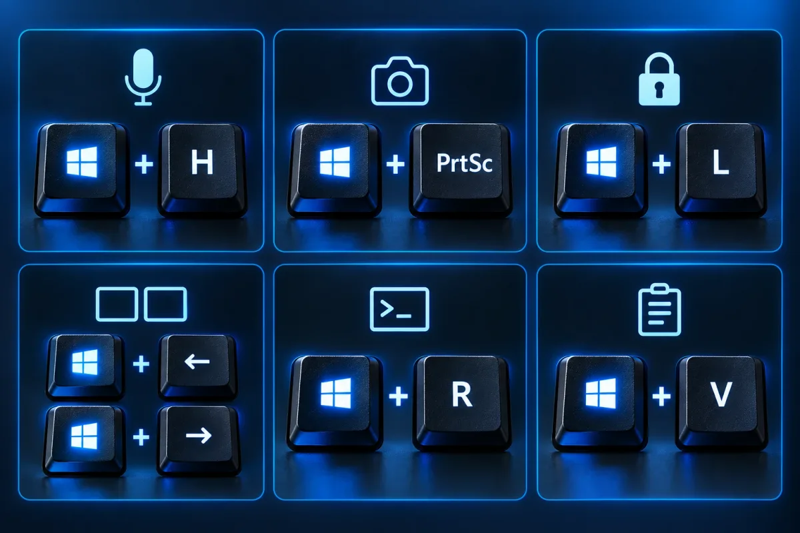

A **tecla Windows**, aquela com o logotipo entre Ctrl e Alt, abre dezenas de atalhos que poupam cliques todos os dias. Com ela dá para ditar texto, tirar print, bloquear o PC, organizar janelas e até atualizar todos os programas de uma vez.

Quase tudo abaixo vale para o Windows 10 e para o 11. Onde houver diferença entre as versões, ela vem indicada. Para quem gosta de ganhar tempo no teclado, o [guia de comandos do cmd do Windows](/cmd-comandos-windows/) é o par natural deste texto.

## Os 5 atalhos que mais valem a pena

Se for decorar só alguns, comece por estes.

| Atalho | O que faz |
| --- | --- |
| **Win + H** | Abre a digitação por voz: você fala e o Windows escreve |
| **Win + PrtSc** | Tira um print da tela inteira e salva sozinho |
| **Win + L** | Bloqueia o computador na hora |
| **Win + ← / →** | Encaixa a janela na metade esquerda ou direita da tela |


| **Win + R** | Abre a caixa Executar, porta de entrada para o cmd |

### Win + H: digitação por voz

Com o cursor em qualquer campo de texto (Word, navegador, WhatsApp Web), aperte **Win + H**. Uma barra com um microfone aparece, e basta falar. O Windows coloca o texto no lugar e entende pontuação falada, como "vírgula" e "ponto final".

O recurso precisa de internet e de um microfone configurado. Para parar, aperte Win + H de novo ou clique no microfone. É bom para rascunhos longos, e vale conferir o resultado antes de enviar.

### Win + PrtSc: print salvo direto na pasta

Ao apertar **Win + PrtSc**, a tela pisca por um instante e o print é salvo como PNG, sem precisar colar em lugar nenhum. O arquivo vai para **Imagens > Capturas de tela**, dentro da sua pasta de usuário.

Em alguns notebooks a tecla PrtSc divide espaço com outra função. Se nada acontecer, tente **Win + Fn + PrtSc**. Para capturar só uma parte da tela, use o Win + Shift + S, explicado mais abaixo.

### Win + L: bloquear o computador

Levantou da mesa? Aperte **Win + L** e a tela volta para o login, com seus programas e arquivos abertos exatamente como estavam. Para voltar, basta digitar a senha ou o PIN. É o hábito de segurança mais simples para quem divide o ambiente com outras pessoas.

### Win + setas: encaixar janelas

Com uma janela ativa, **Win + seta para a esquerda** gruda ela na metade esquerda da tela, e **Win + seta para a direita** faz o mesmo no lado direito. Duas janelas lado a lado ficam prontas em dois segundos, ótimo para comparar documentos.

As outras duas setas completam o conjunto: **Win + ↑** maximiza a janela e **Win + ↓** restaura o tamanho anterior (e, apertado de novo, minimiza). No Windows 11, **Win + Z** abre o painel de layouts de encaixe, com divisões em três colunas e outras combinações.

## Básicos do dia a dia

| Atalho | O que faz |
| --- | --- |
| **Win** | Abre o menu Iniciar, onde já dá para digitar para buscar |
| **Win + D** | Mostra a área de trabalho; apertar de novo devolve as janelas |
| **Win + M** | Minimiza todas as janelas |
| **Win + E** | Abre o Explorador de Arquivos |
| **Win + I** | Abre as Configurações |
| **Win + S** | Abre a pesquisa do Windows |
| **Win + R** | Abre a caixa Executar |
| **Win + V** | Abre o histórico da área de transferência |
| **Win + .** (ponto) ou **Win + ;** | Abre o painel de emojis, símbolos e kaomojis |
| **Win + 1 a 9** | Abre ou alterna para o app fixado naquela posição da barra de tarefas |

O **Win + V** merece destaque. Ele guarda os últimos itens copiados (texto e imagens), e você escolhe qual colar. Na primeira vez, o Windows pede para ativar o histórico. Já o **Win + número** conta os ícones da barra da esquerda para a direita: Win + 1 abre o primeiro, Win + 2 o segundo, e assim por diante.

## Janelas, telas e áreas de trabalho

| Atalho | O que faz |
| --- | --- |
| **Win + Tab** | Mostra todas as janelas e as áreas de trabalho virtuais |
| **Win + Ctrl + D** | Cria uma nova área de trabalho virtual |
| **Win + Ctrl + ← / →** | Alterna entre as áreas de trabalho virtuais |
| **Win + Ctrl + F4** | Fecha a área de trabalho virtual atual |
| **Win + Shift + ← / →** | Move a janela ativa para outro monitor |
| **Win + P** | Escolhe como projetar: só o PC, duplicar, estender ou segunda tela |
| **Win + ,** (vírgula) | Espia a área de trabalho enquanto a tecla estiver pressionada |
| **Win + Home** | Minimiza tudo, menos a janela ativa |

As áreas de trabalho virtuais organizam melhor o dia: uma para o trabalho, outra para estudos, outra para lazer. O **Win + P** é o salvador de quem usa projetor ou TV como segunda tela. Quando o monitor extra não aparece, é aqui que se resolve.

## Captura e gravação de tela

| Atalho | O que faz |
| --- | --- |
| **Win + Shift + S** | Abre a ferramenta de recorte para capturar uma área, uma janela ou a tela |
| **Win + PrtSc** | Print da tela inteira salvo em Imagens > Capturas de tela |
| **Win + Alt + PrtSc** | Print da janela ativa (Game Bar), salvo em Vídeos > Capturas |
| **Win + G** | Abre a Xbox Game Bar |
| **Win + Alt + R** | Inicia e para a gravação de vídeo da janela ativa |
| **Win + Alt + G** | Grava os últimos instantes, se a gravação em segundo plano estiver ativada |

O **Win + Shift + S** copia o recorte para a área de transferência e mostra uma miniatura para editar ou salvar. A gravação pela Game Bar funciona com a janela de um programa, não grava a área de trabalho nem o Explorador de Arquivos. Os vídeos ficam em **Vídeos > Capturas**.

## Produtividade e conexão

| Atalho | O que faz |
| --- | --- |
| **Win + A** | No Windows 11: configurações rápidas (Wi-Fi, volume, brilho). No Windows 10: Central de Ações |
| **Win + N** | No Windows 11: notificações e calendário |
| **Win + W** | No Windows 11: painel de widgets |
| **Win + K** | Abre a transmissão de tela para TV ou dispositivo compatível (Miracast) |
| **Win + Espaço** | Alterna entre idiomas e layouts de teclado |
| **Win + B** | Move o foco para a área de notificações da barra |
| **Win + T** | Percorre os ícones da barra de tarefas |

## Atalhos avançados e de sistema

| Atalho | O que faz |
| --- | --- |
| **Win + X** | Abre o menu de energia e de ferramentas (também no clique direito no Iniciar) |
| **Win + Pause/Break** | Abre a página Sobre do sistema, com processador, memória e versão do Windows |
| **Win + Ctrl + Shift + B** | Reinicia o driver de vídeo quando a tela fica preta ou congela |
| **Win + Ctrl + C** | Liga e desliga os filtros de cor (precisa estar habilitado em Acessibilidade) |
| **Win + +** (mais) | Abre a Lupa para ampliar a tela |
| **Win + U** | Abre as configurações de acessibilidade |
| **Win + Ctrl + O** | Abre o teclado na tela |

O **Win + X** dá acesso rápido ao Gerenciador de Dispositivos, ao Gerenciamento de Disco, ao Terminal e a opções de desligar. O **Win + Ctrl + Shift + B** é um truque pouco conhecido: a tela dá um piscar breve e um aviso sonoro, e o computador continua ligado, sem perder o que estava aberto. O **Win + Ctrl + C**, que ativa filtros para daltonismo, só responde depois de você habilitar o atalho em Configurações > Acessibilidade > Filtros de cor.

## Win + R e winget: atualize todos os programas

Este é o atalho que mais economiza tempo de manutenção. O **winget** é o gerenciador de pacotes da Microsoft, que vem no Windows 11 e em versões atuais do Windows 10. Com ele, uma sequência curta atualiza os programas instalados.

1.  Aperte **Win + R** para abrir o Executar
2.  Digite `cmd` e aperte **Ctrl + Shift + Enter** para abrir já como administrador (confirme o aviso do Controle de Conta de Usuário). Com só Enter, o cmd abre normal, e alguns programas vão pedir permissão elevada na hora de atualizar
3.  Rode o comando que lista as atualizações disponíveis:

```cmd
winget upgrade
```

Aparece uma tabela com nome, versão instalada e versão nova de cada programa. Confira a lista antes de seguir: se algo não deve mudar (um programa que você usa em versão específica, por exemplo), anote o nome. Na primeira execução, o winget pode pedir que você aceite os termos das fontes; digite `S` ou `Y` e confirme, conforme o idioma da mensagem.

4.  Para atualizar tudo de uma vez, rode:

```cmd
winget upgrade --all
```

O winget baixa e instala uma atualização por vez. Feche os programas abertos antes, porque alguns instaladores pedem para encerrar o app. Se um item falhar, o restante segue, e dá para repetir o comando depois. Para atualizar um programa só, use `winget upgrade --id` seguido do ID mostrado na tabela. A [documentação oficial do winget upgrade](https://learn.microsoft.com/pt-br/windows/package-manager/winget/upgrade) lista todas as opções.

Um cuidado final: o winget só atualiza programas que ele reconhece, então a lista pode não incluir tudo o que está no PC. Programas de fontes duvidosas continuam por sua conta. Para mais comandos úteis do Prompt, veja o texto sobre os [comandos do cmd para disco, vírus e tarefas](/cmd-comandos-windows/).

## Windows 10 e Windows 11: onde muda

A maior parte das tabelas vale para as duas versões. As diferenças práticas estão em poucos pontos:

- **Win + A**: configurações rápidas no 11, Central de Ações no 10
- **Win + N**: painel de notificações e calendário no 11
- **Win + W**: widgets só no 11
- **Win + Z**: layouts de encaixe só no 11

Para a lista completa e atualizada, a [página de atalhos de teclado do Windows](https://support.microsoft.com/pt-br/windows/atalhos-de-teclado-no-windows-dcc61a57-8ff0-cffe-9796-cb9706c75eec), no suporte da Microsoft, é a referência.

## Conclusão

Os atalhos da tecla Windows trocam muitos cliques por um toque de dedo. Comece por Win + H, Win + PrtSc, Win + L e Win + setas, depois some o Win + V e o Win + Shift + S, que mudam a rotina de quem copia e cola o dia inteiro. E reserve um momento da semana para o par `winget upgrade` e `winget upgrade --all`.

Se o PC ainda estiver lento depois disso, siga o passo a passo para [limpar os arquivos temporários do Windows](/limpar-arquivos-temporarios-windows/). E, se o gargalo for o navegador, compare o [melhor navegador para PC](/melhor-navegador-para-pc/).

## Perguntas frequentes

### Os atalhos da tecla Windows funcionam no Windows 10 e no 11?

_A maioria funciona nos dois. As diferenças aparecem em painéis: no Windows 11, Win + A abre as configurações rápidas e Win + N abre as notificações; no Windows 10, Win + A abre a Central de Ações._

### Por que o Win + V não mostra nada na primeira vez?

_O histórico da área de transferência precisa ser ativado uma vez. Aperte Win + V e clique no botão para ativar. Depois disso, tudo o que você copiar fica guardado._

### O winget upgrade --all é seguro?

_Em geral sim, porque baixa as versões novas das fontes do próprio winget. Mesmo assim, rode antes o winget upgrade para ler a lista e feche os programas abertos._

Fontes: [Microsoft: atalhos de teclado no Windows](https://support.microsoft.com/pt-br/windows/atalhos-de-teclado-no-windows-dcc61a57-8ff0-cffe-9796-cb9706c75eec) | [Microsoft: winget upgrade](https://learn.microsoft.com/pt-br/windows/package-manager/winget/upgrade)
