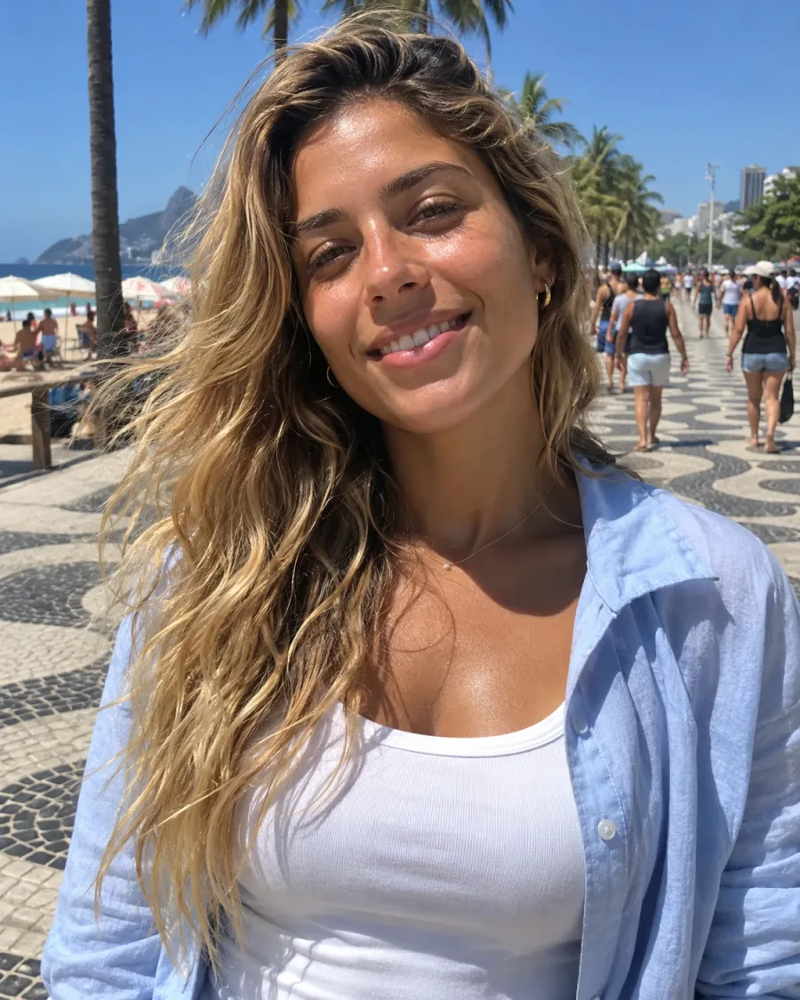
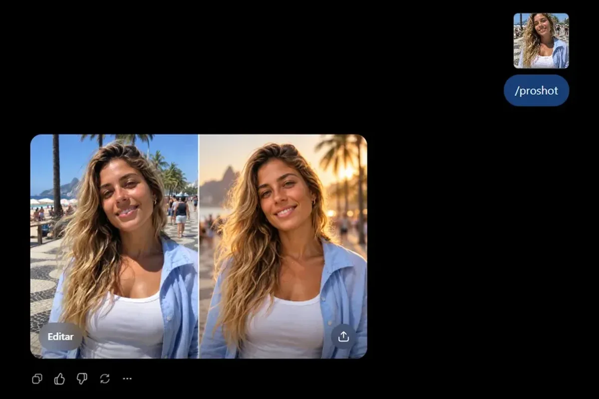
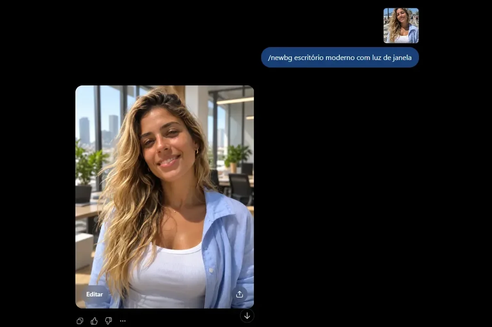
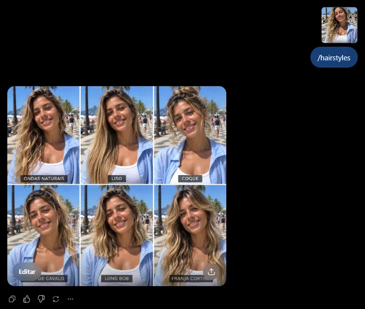
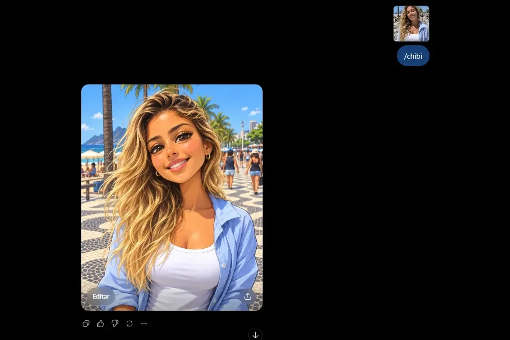

Dá para enviar uma foto sua ao ChatGPT e pedir uma mudança com **uma palavra só**: melhorar o retrato, trocar o fundo, mudar a luz. Basta **enviar a foto e escrever um comando com barra**, como `/proshot` ou `/newbg`. Este guia mostra como editar foto com o ChatGPT: o passo a passo, os 12 comandos e os textos prontos para copiar. Se você procura os atalhos de ângulo e perspectiva, veja os [100 comandos do ChatGPT para imagens](/comandos-do-chatgpt/); para mudar só o ângulo da câmera, o [guia de ângulos de câmera com IA](/angulos-de-camera-prompt-ia/) explica com exemplos.

Duas coisas para ter em mente desde já. Esses comandos **não são um recurso oficial** do ChatGPT: são uma convenção popular, e o modelo lê a palavra e entende o pedido, então o resultado muda de uma geração para outra. E a IA **redesenha** a imagem em vez de só retocá-la, por isso o rosto e os detalhes podem mudar um pouco. Os textos deste artigo são sugestões, escritas a partir de guias publicados. Testei `/proshot`, `/newbg`, `/hairstyles` e `/chibi` no ChatGPT com uma foto de exemplo, e os prints estão logo abaixo; os demais comandos não foram testados, e o resultado varia conforme a versão do modelo, que a fonte não informa. Pesquisa e testes feitos em 21/10/2026.

## Veja na prática: quatro comandos no ChatGPT

Para testar, usei esta foto de exemplo, de uma personagem fictícia criada por IA, no calçadão de Copacabana, no Rio de Janeiro. De propósito, ela tem cara de foto comum de celular: sol forte de meio-dia, sombras marcadas e um fundo movimentado.



O teste foi simples: **enviei a foto pelo clipe de papel e escrevi só o comando**, sem frase de apoio. Cada comando em uma conversa nova.

### `/proshot` no ChatGPT

Escrevi apenas `/proshot`. O print mostra a conversa: a foto enviada (miniatura no alto), o comando e o resultado.



O ChatGPT devolveu uma imagem **lado a lado**: a foto original à esquerda e a versão editada à direita. Na editada, a luz ficou dourada, como num fim de tarde, o fundo ficou desfocado com o morro ao pôr do sol, e o rosto, o cabelo e as roupas parecem os mesmos da original. Repare que o resultado não foi bem um retrato de estúdio: o ChatGPT interpretou o `/proshot` como uma versão mais polida da mesma cena. Se você quer o fundo neutro de estúdio, use o prompt completo mais abaixo.

### `/newbg` no ChatGPT

Escrevi `/newbg escritório moderno com luz de janela`, dizendo qual fundo eu queria.



Aqui o efeito foi mais claro: a mulher continuou com o mesmo cabelo, a mesma camisa e quase a mesma pose, mas o fundo virou um escritório moderno, com janelas grandes, prédios ao longe, plantas e mesas desfocadas. A imagem veio na vertical, como a original. Vale conferir o rosto e os detalhes com a foto de origem, porque a IA redesenha a imagem inteira.

### `/hairstyles` no ChatGPT

Escrevi apenas `/hairstyles`, sem dizer quais cortes eu queria.



O ChatGPT devolveu uma **colagem com seis quadros**, todos com o mesmo fundo do calçadão e a mesma camisa. O que muda é o cabelo, e cada quadro vem com uma legenda em português, como "ondas naturais", "liso", "coque", "long bob" e "franja cortina" (duas legendas ficaram parcialmente escondidas pelos botões do ChatGPT no print). O rosto parece o mesmo da foto original nos seis quadros, mas vale conferir um a um antes de usar.

### `/chibi` no ChatGPT

Escrevi apenas `/chibi`.



O resultado virou um **retrato em estilo de desenho**, com olhos grandes e traços suavizados, mantendo o cabelo loiro ondulado, a camisa azul-clara, a regata branca, os brincos e o fundo do calçadão, tudo ilustrado. Mas não saiu o boneco clássico de corpo pequeno e cabeça grande: como o enquadramento ficou do peito para cima, o corpo nem aparece. Para ter o boneco de corpo inteiro, peça isso no prompt, como no texto pronto mais abaixo.

### O que esses testes ensinam

- **Um comando curto já funciona.** Enviar a foto e escrever o comando bastou nos quatro testes.
- **O mesmo comando pode virar coisas diferentes.** O `/proshot` deu uma comparação lado a lado com luz dourada, e não o retrato de estúdio que muita gente espera. Se vier outra coisa, peça o ajuste.
- **Diga o que você quer no comando.** O `/newbg` com o nome do fundo deu um resultado direto. Sem isso, o ChatGPT escolhe o cenário.
- **Efeitos de estilo dependem do enquadramento.** O `/chibi` virou um retrato em desenho, e não o boneco de corpo inteiro. Se quiser o corpo, peça "corpo inteiro, de pé".
- **Confira os detalhes.** Compare rosto, roupas e fundo com a foto original antes de usar.

## Qual IA usar

Você precisa de uma IA que aceite **enviar uma foto e pedir uma alteração**. Os comandos desta lista foram descritos para o **ChatGPT**, que funciona no celular e no computador:

- **No aplicativo ou em chatgpt.com**, envie a foto pelo clipe de papel (ou pelo botão de "+") e escreva o pedido.
- **Em outras IAs**, como o Gemini, os comandos com barra não são um recurso próprio. Se quiser testar, escreva o pedido por extenso, como nos prompts completos abaixo.

Segundo Schieb, uma conta gratuita do ChatGPT funciona, com um limite diário de imagens. Se ainda não conhece as versões do ChatGPT, veja [o que muda entre a gratuita e a paga](/chatgpt-gratis-ou-pago/).

## Passo a passo: da sua foto à imagem editada

1. **Escolha uma foto nítida**, com a pessoa ou o objeto bem iluminado e sem nada na frente.
2. **Abra o ChatGPT** e comece uma conversa nova.
3. **Envie a foto** pelo clipe de papel ou pelo botão de "+".
4. **Escreva o comando.** A versão mais simples é só ele, como `/proshot`. Para ter mais controle, cole um dos prompts prontos mais abaixo.
5. **Envie e aguarde.** A imagem nova aparece na própria conversa.
6. **Se não ficou como queria, peça o ajuste** na mesma conversa. Há frases prontas na seção "Não ficou como queria?".

O comando curto basta para testar. Para mais controle, diga três coisas: **o que mudar, o que deve continuar igual e que a foto enviada é a base**. Assim o ChatGPT altera só o que você pediu.

## Os 12 comandos: qual escolher

O quadro mostra o que cada comando faz e para que serve. Clique em "Copiar" para guardar o termo.

| Comando | O que faz | Bom para | Copiar |
|---|---|---|---|
| `/proshot` | Dá aparência de estúdio ao retrato | Foto de perfil, LinkedIn | 📋 Copiar |
| `/hdreal` | Aumenta a nitidez e reduz o ruído | Foto tremida ou com pouca luz | 📋 Copiar |
| `/closeup` | Aproxima o enquadramento | Rosto ou detalhe do objeto | 📋 Copiar |
| `/hairstyles` | Mostra cortes e cores de cabelo | Testar um visual novo | 📋 Copiar |
| `/sunglassestryon` | Prova óculos de sol na pessoa | Escolher um modelo | 📋 Copiar |
| `/newbg` | Troca o fundo e mantém a pessoa | Foto de perfil, anúncio | 📋 Copiar |
| `/fog` | Adiciona neblina à cena | Paisagem, manhã na cidade | 📋 Copiar |
| `/goldenhour` | Aplica luz dourada de fim de tarde | Foto feita com sol forte | 📋 Copiar |
| `/droneview` | Mostra a cena como em foto de drone | Cenário, viagem | 📋 Copiar |
| `/together` | Junta pessoas de duas fotos numa cena | Foto de casal ou de amigos | 📋 Copiar |
| `/blueprint` | Vira um desenho técnico azul e branco | Objeto, prédio | 📋 Copiar |
| `/chibi` | Cria um boneco de cabeça grande | Avatar, figurinha | 📋 Copiar |

## Prompts prontos para melhorar o retrato

Envie a foto primeiro e depois cole um destes textos. Cada caixa tem o botão de copiar. O molde é sempre o mesmo: **"use minha foto" + "mude só isto" + "mantenha o resto"**.

**`/proshot`: foto de perfil mais profissional**

```prompt
/proshot Use a foto que enviei como base e deixe-a com aparência de retrato profissional de estúdio: luz suave no rosto, fundo levemente desfocado e enquadramento do peito para cima. Mantenha meu rosto, minha expressão e minhas roupas sem alterações.
```

**`/hdreal`: mais nitidez e detalhe**

```prompt
/hdreal Use a foto que enviei como base, aumente a nitidez e reduza o ruído. Preserve as cores, o rosto e as proporções originais, sem inventar elementos novos.
```

Atenção: o modelo acrescenta detalhe, não reconstrói o que existia. Em fotos muito ruins, ele pode inventar.

**`/closeup`: aproximar o assunto**

```prompt
/closeup Use a foto que enviei como base e aproxime o enquadramento no meu rosto, com foco nos olhos e fundo desfocado. Mantenha minha expressão e minhas roupas.
```

**`/hairstyles`: testar cortes e cores**

```prompt
/hairstyles Use a foto que enviei como base e me mostre com quatro cortes e cores de cabelo diferentes, numa colagem. Mantenha meu rosto idêntico em todas as versões.
```

**`/sunglassestryon`: provar óculos de sol**

```prompt
/sunglassestryon Use a foto que enviei como base e me mostre com três modelos de óculos de sol: aviador, quadrado e redondo. Mantenha meu rosto e minhas roupas como estão.
```

É uma prova virtual com modelos comuns, e não com produtos de marcas específicas.

## Prompts prontos para mudar o cenário e a luz

**`/newbg`: trocar o fundo**

```prompt
/newbg Use a foto que enviei como base, mantenha a pessoa exatamente como está e troque só o fundo por um escritório claro e organizado, com luz natural de janela.
```

Dizer qual fundo você quer ajuda muito.

**`/goldenhour`: luz dourada de fim de tarde**

```prompt
/goldenhour Use a foto que enviei como base e refaça a iluminação com luz quente de fim de tarde, sombras longas e tons dourados. Mantenha a pessoa e o cenário como estão.
```

Pode ajudar numa foto feita ao meio-dia, com sol forte.

**`/fog`: neblina na cena**

```prompt
/fog Use a foto que enviei como base e adicione neblina leve, como numa manhã fria, sem esconder o assunto principal. Mantenha o resto da imagem.
```

**`/droneview`: visão de drone**

```prompt
/droneview Use a foto que enviei como base e mostre essa cena como numa foto aérea de drone, ao pôr do sol, com o assunto principal no centro.
```

O modelo inventa o ambiente ao redor, e você pode complementar com o horário.

## Prompts prontos para versões divertidas

**`/together`: duas fotos, uma cena**

```prompt
/together Use as duas fotos que enviei como base e una as pessoas numa única cena, lado a lado, num parque ao entardecer, com a mesma luz para as duas. Mantenha o rosto de cada uma.
```

Funciona melhor quando a iluminação das duas fotos é parecida.

**`/blueprint`: desenho técnico**

```prompt
/blueprint Use a foto que enviei como base e transforme o objeto num desenho técnico de engenharia, com fundo azul, linhas brancas e cotas ilustrativas.
```

As medidas que aparecem são inventadas pelo modelo.

**`/chibi`: boneco de cabeça grande**

```prompt
/chibi Use a foto que enviei como base e transforme a pessoa num personagem chibi de corpo inteiro, de pé: corpo pequeno, cabeça grande, olhos grandes e as mesmas roupas e cores da foto.
```

Boa opção para avatar ou figurinha. No meu teste com só `/chibi`, o resultado foi um retrato em desenho; pedir "corpo inteiro, de pé" é a forma de tentar o boneco completo.

## Não ficou como queria? Peça o ajuste

Não comece outra conversa. Responda na mesma, pedindo uma coisa por vez:

- "Parece outra pessoa. Mantenha exatamente o meu rosto da foto original."
- "O efeito ficou exagerado. Faça uma versão mais suave."
- "Mantenha o fundo igual ao da foto original e mude só a luz."
- "Refaça sem texto e sem logotipos na imagem."

Se o atalho continuar longe do que você esperava, o caminho mais confiável é o prompt completo, com o que manter e o que mudar. O erro mais comum é pedir "melhore esta foto" sem dizer que o rosto não deve mudar.

## Como combinar comandos

Dá para juntar comandos, como `/proshot /goldenhour`. A recomendação de Schieb é usar no máximo dois ou três, porque pedidos que se contradizem podem ser ignorados. Evite pedir `/fog` e `/goldenhour` juntos sem explicar a prioridade, porque neblina densa e sol baixo brigam entre si.

## O que esperar (e o que não esperar)

- **O resultado é uma imitação plausível, não uma prova.** O que não aparece na foto original é inventado pelo modelo. Não use para comprovar dano em seguro, documentar ocorrência ou ilustrar notícia.
- **O rosto pode mudar.** Confira com a foto original antes de usar.
- **Peça autorização antes de enviar a foto de outra pessoa**, e nunca envie documentos ou fotos de crianças.
- **Dados enviados podem ser usados em treinamento.** Schieb recomenda desativar essa opção em "Controles de dados", nas configurações do ChatGPT. As regras podem mudar, então confira a ajuda oficial da OpenAI.

Se quiser usar o mesmo raciocínio para foto de loja e anúncio, veja os [8 prompts para foto de produto no ChatGPT](/prompt-foto-de-produto-chatgpt/). E para levar a mesma lógica ao vídeo, há os [comandos de câmera do Google Flow](/comandos-camera-google-flow/). Quem curtiu a ideia de transformar a própria foto também pode testar a [trend dos anos 80 com IA](/trend-anos-80-ia-foto-prompt/).

## Perguntas frequentes

### Os comandos do ChatGPT para editar fotos são oficiais?

Não. Segundo o jornalista Jörg Schieb, a OpenAI nunca criou uma lista, uma documentação nem uma configuração para eles. São atalhos populares nas redes, que o ChatGPT interpreta como um pedido comum. Por isso o resultado muda de uma tentativa para outra.

### O ChatGPT muda o meu rosto quando edita a foto?

Pode mudar. A IA redesenha a imagem a partir da sua foto, em vez de apenas retocá-la. Por isso, peça sempre para manter o rosto, a expressão e as roupas, e confira o resultado com a foto original antes de usar.

### Preciso pagar para editar fotos com os comandos?

Segundo o artigo de Schieb, uma conta gratuita do ChatGPT funciona, com um limite diário de imagens. Esse limite muda com o tempo, então confira na própria conversa quando o ChatGPT avisar que acabou.

### Posso criar meus próprios comandos?

Pode. Como os comandos são só palavras que o ChatGPT interpreta, você pode inventar os seus. Schieb cita exemplos como `/vintagefilm`, `/polaroid`, `/noir` e `/isometric`. Descreva o efeito no mesmo pedido para a IA entender o que você quer.

## Resumo para guardar

1. Abra o ChatGPT e envie a sua foto.
2. Escreva o comando (`/proshot`, `/newbg`...) ou cole o prompt completo.
3. Mantenha o molde: "use minha foto, mude só isto, mantenha o resto".
4. Se não ficou bom, peça o ajuste na mesma conversa, uma coisa por vez.
5. Confira o rosto e os detalhes antes de usar a imagem.

Guia completo: para foto de produto, veja os [8 prompts para foto de produto no ChatGPT](/prompt-foto-de-produto-chatgpt/).

Guia completo: para mudar só a luz da sua foto, veja os [comandos de luz para fotos com IA](/comandos-iluminacao-ia-foto/), com prompts prontos de golden hour, neblina e contraluz.

Fontes: [Jörg Schieb, ChatGPT-Bildbefehle (schieb.de, 04/09/2026)](https://www.schieb.de/?p=814488) | [Canaltech, 12 comandos para criar ou editar imagens no ChatGPT](https://canaltech.com.br/inteligencia-artificial/12-comandos-para-criar-ou-editar-imagens-no-chatgpt/) | [OpenAI: geração de imagens no ChatGPT](https://help.openai.com/en/articles/9055440-image-generation-in-chatgpt)
