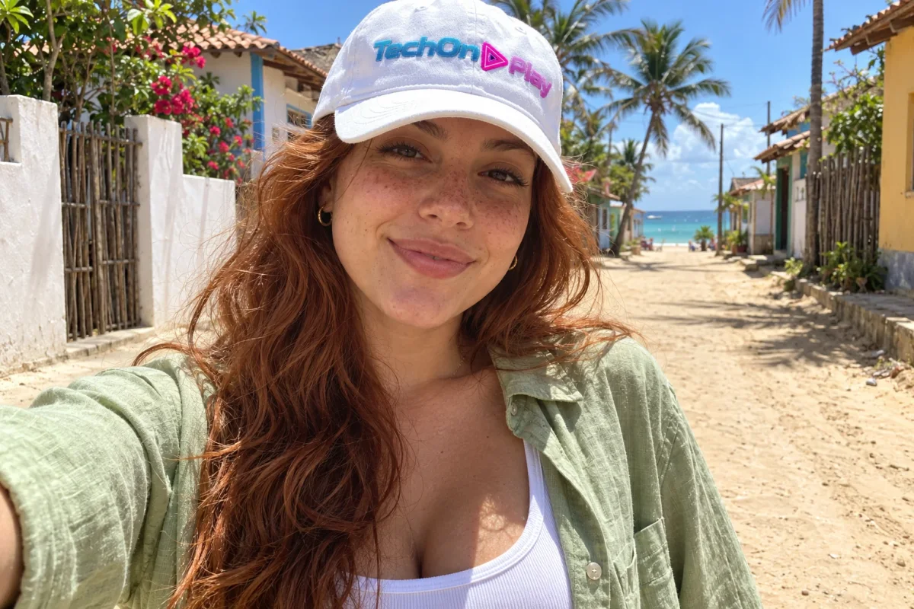
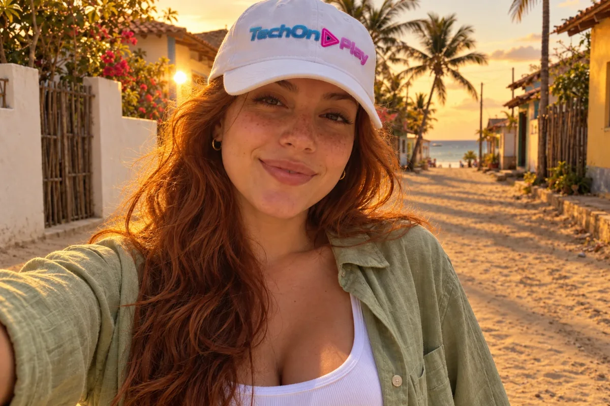
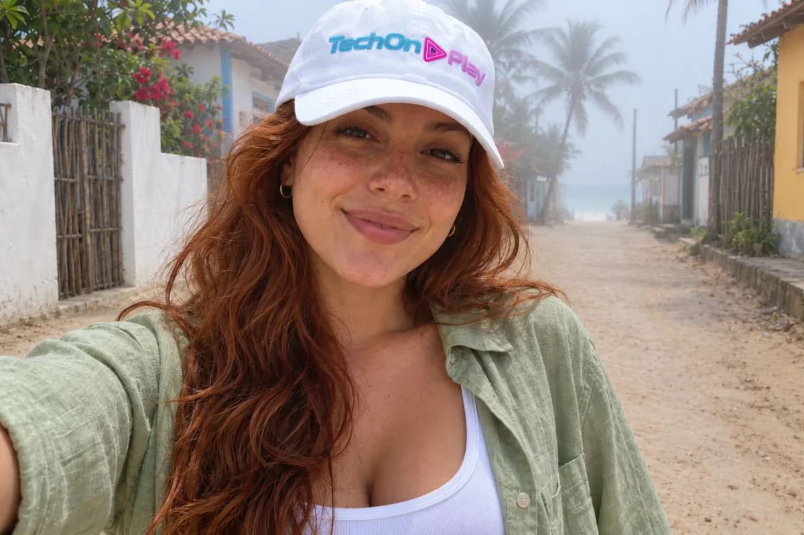
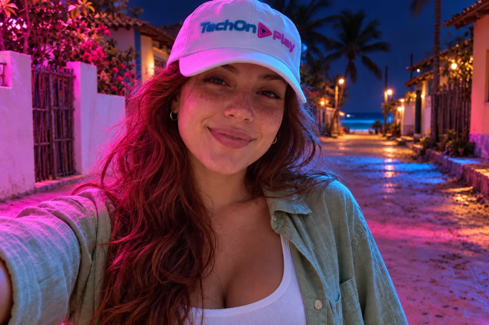

Uma foto boa muitas vezes é uma foto com a luz certa. Com IA, dá para pegar uma imagem tirada ao meio-dia, com sol duro e sombra feia, e pedir que ela pareça feita no fim da tarde, numa manhã de neblina ou numa rua com neon. Basta **enviar a foto e escrever um comando de luz**, como `golden hour` ou `fog`. Este guia mostra como fazer isso passo a passo, com 8 comandos e prompts prontos. A lista maior de atalhos, com mais de cem efeitos, está nos [100 comandos do ChatGPT para imagens](/comandos-do-chatgpt/); para trocar fundo e melhorar o retrato, veja os [comandos do ChatGPT para editar fotos](/comandos-chatgpt-editar-fotos/).

Dois avisos antes de começar. Os comandos com barra, como `/goldenhour` e `/fog`, são uma **convenção informal das redes sociais**, e não um recurso oficial de nenhuma ferramenta: o ChatGPT e o Gemini apenas leem o termo como um pedido comum. E os prompts deste artigo são sugestões minhas, montadas a partir de guias publicados. **Testei três deles no ChatGPT** (golden hour, neblina e neon), com o resultado logo abaixo de cada prompt; os demais não foram testados. O resultado muda conforme a ferramenta, a versão e a foto, e não registrei a versão do modelo. Pesquisa e testes feitos em 22/10/2026. A personagem das fotos de exemplo é fictícia, criada por IA.

## Qual IA usar e onde colar o comando

Você precisa de uma IA que aceite **enviar uma foto e pedir uma alteração**:

- **ChatGPT**: no aplicativo ou em chatgpt.com, envie a foto pelo clipe de papel (ou pelo botão de "+") e escreva o pedido.
- **Gemini**: no aplicativo ou em gemini.google.com, envie a foto pelo botão de "+" e peça do mesmo jeito.

Os dois têm versão gratuita com limite diário de imagens, e esse limite muda com o tempo. Se um avisar que acabou, tente o outro. Se está começando, veja [como funciona o ChatGPT gratuito e o pago](/chatgpt-gratis-ou-pago/).

## Passo a passo: da luz dura à luz que você quer

1. **Escolha uma foto** em que o rosto e o cenário apareçam com clareza. Fotos muito escuras ou tremidas dão resultado pior.
2. **Abra o ChatGPT ou o Gemini** e comece uma conversa nova.
3. **Envie a foto.**
4. **Escreva o comando de luz.** A versão mais simples é só o termo, como `golden hour`. Para ter mais controle, cole um dos prompts completos mais abaixo.
5. **Envie e aguarde.** A imagem nova aparece na própria conversa.
6. **Se não ficou como queria, peça o ajuste** na mesma conversa (há frases prontas mais abaixo).

## Os 8 comandos de luz

A coluna "Comando" traz o termo em inglês, porque os modelos de imagem costumam responder bem a ele. Você pode escrever com ou sem a barra.

| Luz | Comando | O que muda na foto | Bom para | Copiar |
|---|---|---|---|---|
| Fim de tarde | `/goldenhour` | Luz quente, tons dourados, sombras longas | Retrato, viagem | 📋 Copiar |
| Depois do pôr do sol | `/bluehour` | Luz azulada e calma | Cidade, paisagem | 📋 Copiar |
| Neblina | `/fog` | Névoa leve, clima de manhã fria | Paisagem, rua | 📋 Copiar |
| Contraluz | `/backlight` | Sol atrás da pessoa, contorno brilhante no cabelo | Retrato | 📋 Copiar |
| Luz de contorno | `/rimlight` | Fio de luz nas bordas, fundo escuro | Retrato dramático | 📋 Copiar |
| Neon | `/neonglow` | Luzes coloridas refletindo no rosto | Cena noturna | 📋 Copiar |
| Luz suave de estúdio | `/softbox` | Luz difusa, sombras suaves | Retrato, produto | 📋 Copiar |
| Luz dramática | `/dramaticlight` | Contraste alto, sombras marcadas | Foto com clima de cinema | 📋 Copiar |

Esses nomes aparecem na lista do pilar do blog e circulam como atalhos; nenhum deles vem de uma documentação oficial.

## Prompts prontos para colar

Envie a foto primeiro e depois cole um destes textos. Todos seguem o molde **"use minha foto + mude só a luz + mantenha o resto"**. Os prompts de golden hour, neblina e neon foram testados por mim no ChatGPT, e o resultado aparece logo abaixo de cada um. Os outros não foram testados.

### A foto de exemplo

Nos três testes usei esta selfie de uma influenciadora fictícia criada por IA, numa rua de areia de uma vila de praia, com um boné branco com o logotipo do TechOnPlay. É uma foto de sol forte de meio-dia, e cada teste foi feito numa conversa nova, enviando esta mesma imagem.



Se a sua foto não tem boné ou outro acessório, apague "meu boné com o logotipo" dos prompts abaixo.

**Luz dourada de fim de tarde:**

```prompt
Use a foto que enviei como base. Mude só a iluminação: golden hour, com sol baixo vindo do lado esquerdo, luz quente, sombras longas e suaves. Mantenha meu rosto, meu cabelo, meu boné com o logotipo, minhas roupas e o cenário como estão na foto original.
```

**Resultado no ChatGPT:**



A luz virou a de fim de tarde: o céu ficou laranja, o sol baixo aparece à esquerda, e um contorno dourado brilha nos fios do cabelo. A areia ganhou sombras longas e suaves, como pedi. O rosto, as sardas, o sorriso, o boné com o logotipo e a roupa parecem os mesmos da foto original, só com tons mais quentes.

**Neblina leve:**

```prompt
Use a foto que enviei como base. Mude só a atmosfera: adicione neblina leve, como numa manhã fria, com luz suave e difusa, sem esconder a pessoa. Mantenha meu rosto, meu cabelo, meu boné com o logotipo, minhas roupas e o cenário como estão na foto original.
```

**Resultado no ChatGPT:**



A neblina apareceu sobretudo ao fundo: as palmeiras e o fim da rua ficaram esbranquiçados, e o mar quase some. As casas mais próximas, dos dois lados da rua, continuam nítidas, e a pessoa não ficou escondida. A luz ficou suave, com o céu mais claro e frio. O rosto, o cabelo e o boné com o logotipo seguem iguais aos da foto original.

**Contraluz com o rosto ainda visível** (não testado):

```prompt
Use a foto que enviei como base. Mude só a iluminação: sol baixo atrás de mim, com contorno de luz brilhante no cabelo e nos ombros, e uma luz suave de preenchimento no meu rosto para ele não ficar escuro. Mantenha o resto como está.
```

**Neon à noite:**

```prompt
Use a foto que enviei como base. Mude só a iluminação: cena noturna com neon magenta vindo da esquerda e reflexos azuis, sombras suaves. Mantenha meu rosto, meu cabelo, meu boné com o logotipo, minhas roupas e a pose como estão na foto original.
```

**Resultado no ChatGPT:**



A cena virou noite: o céu ficou azul-escuro, e a luz magenta vem da esquerda, tingindo o rosto, o cabelo, o boné e os muros, com reflexos azuis na areia. O rosto continua visível, e o logotipo do boné segue legível, só com tom rosado. Mas a IA mexeu no cenário além da luz: acendeu lâmpadas amarelas ao longo da rua e deixou a areia com aspecto molhado e brilhante, o que não estava na foto original.
**Modelo para qualquer outra luz.** Troque a parte entre colchetes pelo termo da tabela:

```prompt
Use a foto que enviei como base. Mude só a iluminação para [softbox / bluehour / rimlight / dramaticlight], vinda do lado [esquerdo / direito]. Mantenha a pessoa, as roupas e o cenário como estão na foto original.
```

## Como descrever a luz: fonte, direção, intensidade e cor

Quando o comando curto não basta, descreva a luz como um caminho. A Kling, empresa de vídeo e imagem com IA, sugere pensar em cinco pontos: a **fonte** (sol, janela, neon), a **direção** (de onde vem e o que ilumina primeiro), a **intensidade** (sombras profundas ou suaves), a **cor** (quente, fria, neutra) e como a luz **some** na imagem. A diferença está na precisão: "luz quente, sombras suaves" é vago, enquanto "luz quente entrando pelo canto esquerdo, sombra fria no peito" dá à IA algo concreto.

Outra dica: a OpenAI orienta, no guia de prompts dos seus modelos de imagem, a combinar "mude só X" com "mantenha todo o resto igual" e, em edições, a [fazer a luz, as sombras e a temperatura de cor combinarem com a foto original](https://developers.openai.com/cookbook/examples/multimodal/image-gen-models-prompting-guide). Na prática, por isso, vale dizer de que lado vem o sol: sombras e brilhos ficam coerentes.

## O que esses testes ensinam

- **"Mude só a luz" funcionou no essencial.** Nos três testes, o rosto, as sardas, o cabelo, o boné com o logotipo, a roupa e a pose parecem os mesmos. O que mudou foi a luz e o clima.
- **A IA mexe um pouco no cenário junto com a luz.** No neon, acendeu lâmpadas e molhou a areia; no pôr do sol, mostrou o sol. Se não quiser isso, escreva "sem alterar o cenário, só a luz".
- **A neblina pode vir só no fundo.** Se quiser mais, peça "neblina mais densa, cobrindo também as casas".
- **Uma foto, três climas.** A mesma selfie virou fim de tarde, noite e manhã de neblina com o mesmo molde de prompt.
- **Confira com a original.** O teste é de uma foto no ChatGPT: com a sua foto, o resultado pode ser diferente.

## Não ficou como queria? Peça o ajuste

Responda na mesma conversa, pedindo uma coisa por vez:

- "O rosto ficou escuro. Clareie o rosto com luz suave, mantendo o contorno dourado."
- "A neblina está forte demais. Faça uma versão bem mais leve."
- "Parece outra pessoa. Mantenha exatamente o meu rosto da foto original."
- "Mantenha o cenário igual ao da foto original; mude só a cor da luz."

Segundo o guia de golden hour da Techpresso, que reúne 30 prompts para o ChatGPT, o contraluz sozinho pode deixar o rosto escuro, e a saída é pedir um preenchimento suave no rosto, mantendo o contorno de luz. Foi o que fiz no prompt de contraluz acima, que não testei.

## O que esperar (e o que não esperar)

- **A IA redesenha a foto.** Rosto, roupas e fundo podem mudar um pouco. Compare com o original antes de usar.
- **O efeito varia entre ferramentas e entre tentativas.** Testei só o ChatGPT; se o resultado não agradar, gere de novo ou teste o Gemini.
- **Uma luz principal por vez.** Combinar duas ou três ideias de luz confunde o modelo. Neblina densa e sol baixo, por exemplo, brigam entre si.
- **Não use medidas exatas.** Detalhes técnicos de câmera, segundo a OpenAI, são interpretados de forma solta. Use a luz para dar o clima geral.
- **Fotos muito escuras têm pouco a aproveitar.** A IA precisa enxergar a cena para refazer a luz.

## Perguntas frequentes

### Dá para mudar só a luz de uma foto com IA?

Dá para pedir isso, mas a IA redesenha a imagem inteira a partir da sua foto. Por isso o prompt deve dizer que só a luz muda e que rosto, roupas e cenário ficam como estão. Confira o resultado com a foto original.

### Os comandos /goldenhour e /fog são oficiais?

Não. São atalhos populares nas redes, que o ChatGPT lê como um pedido comum. Sem a barra, escrever golden hour ou fog funciona do mesmo jeito, e é isso que o Gemini também entende.

### Por que o rosto fica escuro quando peço contraluz?

Porque com o sol atrás da pessoa o rosto tende a ficar na sombra. Peça no mesmo prompt uma luz suave de preenchimento no rosto, mantendo o contorno de luz nos cabelos.

### Posso combinar dois comandos de luz?

Pode, mas escolha uma luz principal. Neblina densa e sol baixo, por exemplo, brigam entre si. Diga qual vale mais, como: neblina leve, com luz dourada vindo do lado esquerdo.

## Resumo para guardar

1. Abra o ChatGPT ou o Gemini e envie a sua foto.
2. Escreva o comando de luz (`golden hour`, `fog`, `backlight`...) ou cole um dos prompts prontos.
3. Mantenha o molde: "use minha foto, mude só a luz, mantenha o resto".
4. Diga de que lado vem a luz e peça luz suave no rosto quando usar contraluz.
5. Peça ajustes na mesma conversa e confira o rosto antes de usar a imagem.

Para vídeo e foto no ecossistema do Google, veja também os [40 comandos de câmera do Flow](/comandos-camera-google-flow/), e para mudar a posição da câmera, o guia de [ângulos de câmera com IA](/angulos-de-camera-prompt-ia/).

Fontes: [Kling: prompts de iluminação para imagens](https://kling.ai/it/blog/image-lighting-fades-effect-ai-prompts) | [Techpresso: prompts de golden hour para o ChatGPT](https://academy.techpresso.co/prompts/chatgpt-prompts-golden-hour-photos) | [OpenAI Cookbook: guia de prompts para modelos de imagem](https://developers.openai.com/cookbook/examples/multimodal/image-gen-models-prompting-guide)
