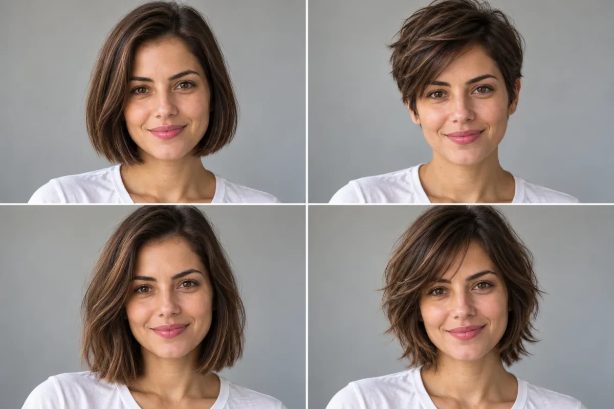
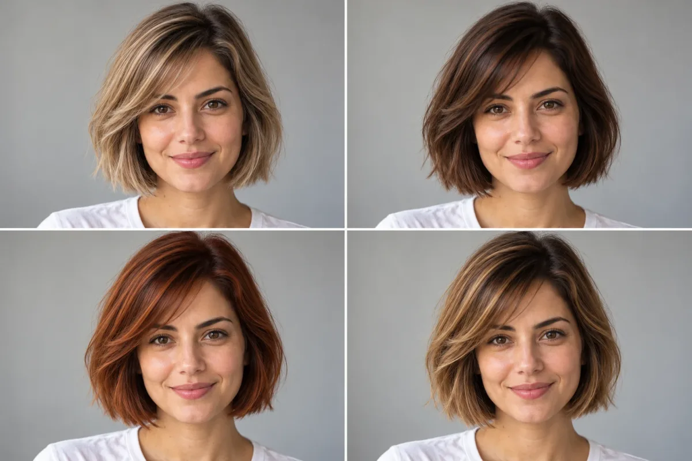
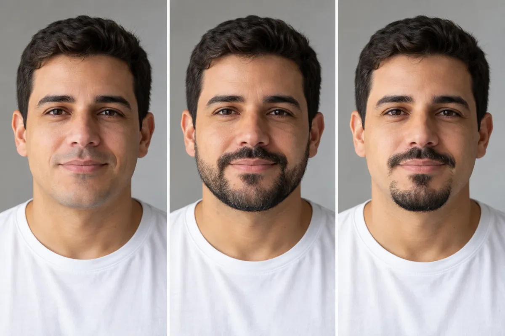

Quem nunca ficou na dúvida se um **cabelo curto** combinaria com o próprio rosto? A trend que viralizou nas redes responde isso em segundos: você envia uma selfie para uma IA e ela mostra **como ficaria seu cabelo curto**, sem tesoura e sem arrependimento. Dá para fazer no ChatGPT ou no Gemini, e o mesmo método serve para testar franja, cor e até barba.

## Como a trend funciona

A ideia é simples: uma foto de rosto, um comando e uma imagem editada em que só o visual muda. É o mesmo princípio das trends de foto que já circularam por aqui, como a [trend dos anos 80 com IA](/trend-anos-80-ia-foto-prompt/), mas com um objetivo prático, o de testar um corte antes de decidir.

Segundo o Caraca FM, a brincadeira ganhou força depois que famosos e influenciadores passaram a postar a versão com cabelo curto feita por IA ao lado da foto original. O DCI registrou, em setembro de 2026, a versão em vídeo do corte chanel, com nomes como Gkay, Brunna Gonçalves, Gustavo Tubarão e Lucas Rangel. Já o portal BNews descreveu, em novembro de 2025, uma onda parecida no Gemini, com uma lista de cortes numerados para escolher. Ou seja, a trend não é de um dia só: ela volta em ondas, sempre que um novo visual pega.

Um detalhe importante: as matérias brasileiras variam na ferramenta. Algumas falam em apps de edição com templates prontos, outras no Gemini. Nenhuma indica um aplicativo único oficial, então o caminho mais seguro é usar um assistente conhecido, como os dois abaixo.

## Passo a passo no ChatGPT ou no Gemini

1. **Escolha uma foto boa.** Rosto de frente, bem iluminado, sem óculos escuros, boné ou mão cobrindo o cabelo.
2. **Abra uma conversa nova** no ChatGPT ou no Gemini e ative a geração de imagens.
3. **Anexe a foto** e cole um dos prompts abaixo.
4. **Compare e peça ajustes** na mesma conversa, mudando só um detalhe por vez.
5. **Salve as versões** que mais gostou para mostrar ao cabeleireiro.

O acesso à geração de imagens e o limite diário dependem do seu plano e mudam com frequência, então confira na própria ferramenta o que a sua conta permite.



*Exemplo gerado por IA (pessoa fictícia). O resultado com a sua foto será diferente.*

## Prompt principal: testar cortes curtos

Este é o prompt base. A frase para não alterar o rosto é a mais importante, porque evita que a IA troque seus traços:

```prompt
Edit the attached photo without changing my face, skin tone, expression or identity. Change only my hair. Give me a short chanel bob cut (chin length, straight, with a clean blunt edge), keeping my natural hair color. Keep the same background, lighting and clothes. Photorealistic result, natural hair texture, no filters, no beauty retouching.
```

Para comparar vários cortes de uma vez, peça uma grade:

```prompt
Using the attached photo, create a 2x2 grid showing the same person, with the same face and identity, in four different short haircuts: pixie cut, classic bob, french bob and wolf cut. Keep the same background and lighting in all four. Photorealistic, natural hair texture, label each cut with a small caption.
```

Os nomes dos cortes funcionam melhor em inglês, como recomenda o BNews, porque os modelos reconhecem esses termos com mais precisão. Você pode escrever o resto do pedido em português sem problema.

## Franja: teste antes de se arrepender

Franja é a mudança que mais dá medo, e por isso é a que mais vale testar:

```prompt
Edit the attached photo without changing my face or identity. Change only my hair by adding curtain bangs (long, parted in the middle, blending into the sides), keeping my current hair length and color. Same background and lighting. Photorealistic, natural texture.
```

Troque "curtain bangs" por "blunt bangs" (franja reta) ou "side-swept bangs" (franja lateral) para ver as variações. Se o seu cabelo é cacheado ou crespo, avise no prompt, pois a franja se comporta de outro jeito nesses fios.

## Cor: do loiro ao cobre

A cor muda a percepção do corte inteiro, então teste em separado:

```prompt
Edit the attached photo without changing my face or identity. Keep my current haircut and change only the hair color to a warm copper red, with a natural gradient and realistic shine. Same background and lighting. Photorealistic, no filters.
```



Tons como "ash blonde", "chocolate brown" e "honey caramel" costumam render bem. Lembre que a IA mostra o resultado ideal: a cor real depende do seu fio de partida, de descoloração e da mão do profissional.

## Barba: a versão masculina

Para quem quer saber se a barba cai bem, o método é o mesmo. O melhor é pedir o estilo pelo nome e pelo comprimento:

```prompt
Edit the attached photo without changing my face shape, skin tone or identity. Change only the facial hair: add a short, well-groomed full beard (about 1 cm, clean neckline and cheek line), matching my hair color. Keep my haircut, background and lighting. Photorealistic skin texture, no retouching.
```

Para testar sem barba, peça "completely clean-shaven" no lugar. Barba por fazer, cavanhaque e bigode também funcionam trocando a descrição.



*Exemplo gerado por IA (pessoa fictícia). O resultado com a sua foto será diferente.*

## Dicas para o resultado ficar parecido com você

- **Uma mudança por vez.** Pedir corte, cor e franja juntos aumenta o risco de o rosto mudar. Se quiser aprender a montar pedidos assim, veja nosso guia de [comandos do ChatGPT para editar fotos](/comandos-chatgpt-editar-fotos/).
- **Repita a ordem de não alterar o rosto** quando pedir um ajuste novo na mesma conversa.
- **Gere mais de uma versão.** Cada tentativa varia, e a segunda costuma ser melhor.
- **Use a imagem como referência, não como promessa.** O comprimento, o volume e a textura reais dependem do seu cabelo.
- **Leve o resultado ao cabeleireiro.** É o uso mais útil da trend: mostrar a imagem e conversar sobre o que é viável no seu fio.

## Cuidados com a sua foto e o seu rosto

Para entrar na trend, você entrega uma imagem do seu rosto a um serviço online. Confira as configurações de privacidade da ferramenta, como o uso de imagens para treinar modelos, e evite enviar fotos de outras pessoas sem permissão, principalmente de crianças. Desconfie de apps que prometem a mesma trend pedindo cadastro, pagamento ou acesso a toda a galeria, e apague a conversa depois de baixar o resultado, se não quiser manter a foto no histórico. Ao postar, deixe claro que a imagem foi feita com IA, como pedem as reportagens sobre a trend.

## Vale a pena?

Para curiosidade e para ter um ponto de partida na conversa com o cabeleireiro, sim. Como decisão final, não: a IA suaviza o que na vida real depende de textura, densidade e crescimento do cabelo. Teste o chanel, a franja, a cor e a barba, escolha seus favoritos e depois leve ao profissional. Se quiser outras ideias do tipo, vale também conferir o que os [melhores prompts de foto profissional](/prompt-foto-profissional-chatgpt/) fazem pelo seu retrato.

Fontes: [Caraca FM](https://caracafm.com.br/trend-de-cabelo-curto-com-ia-viraliza-nas-redes-sociais/) | [DCI](https://www.dci.com.br/industria/beleza/trend-do-cabelo-curto-com-ia-veja-passo-a-passo-para-fazer/) | [BNews São Paulo](https://www.bnewssaopaulo.com.br/noticias/entretenimento/nova-trend-do-gemini-promete-transformar-seu-visual-teste-cortes-de-cabelo-que-estao-bombando.html)
