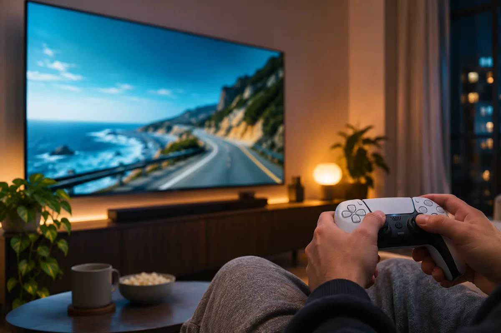

**GTA 6 estreia com meta de 30 FPS no PS5 Pro**, assim como no PS5 Slim e no Xbox Series X|S. A versão de lançamento tem uma única meta de quadros, e o Pro usa sua potência extra para melhorar a nitidez e acrescentar sombras por ray tracing. Se GTA 6 é o motivo da compra, confira o [review do PlayStation 5 com os preços do Slim e do Pro](/playstation-5-preco-review/).

O jogo chegou aos consoles em 19 de novembro de 2026. Os dados abaixo vêm da Rockstar e descrevem a versão de lançamento. Para quem quer entrar em Leonida com poucas informações sobre a campanha, o [guia do primeiro passeio em Vice City](/gta-6-primeiro-passeio-vice-city/) ajuda a explorar a cidade sem spoilers.

## Como GTA 6 roda no PS5 Slim, PS5 Pro e Xbox?

A Rockstar informou a resolução-base usada para renderizar a cena e o método que cada console usa para reconstruir a imagem. O PS5 Slim segue a configuração do PS5 padrão. Os quatro consoles têm **meta de 30 quadros por segundo**. A palavra “meta” indica o desempenho que o estúdio buscou e deixa em aberto como a taxa se comporta em cenas mais pesadas.

| Console | Resolução-base | Reconstrução da imagem |
| --- | --- | --- |
| PS5 padrão e Slim | 1440p | 4K com a técnica temporal da Rockstar |
| PS5 Pro | 1440p | 4K com PSSR 2 |
| Xbox Series X | 1440p | 4K com a técnica temporal da Rockstar |
| Xbox Series S | 720p | 1080p com AMD FSR 4 |

Quando o jogo renderiza em 1440p e reconstrói a imagem para 4K, ele calcula a cena numa resolução menor e usa um algoritmo para preencher detalhes na imagem final. O resultado pode variar mesmo entre aparelhos que começam com o mesmo número de pixels. A equipe técnica também informou que a interface é composta em 4K nos quatro consoles. Isso explica como textos e menus podem ter uma resolução diferente da cena atrás deles.

## O que o PS5 Pro acrescenta?

O Pro usa o **PSSR 2**, a técnica de reconstrução de imagem da PlayStation. A Rockstar destaca o ganho de nitidez e as **sombras por ray tracing** exclusivas do Pro. Na prática, são diferenças para procurar em contornos finos, como grades e folhagens, e no desenho das sombras de postes e palmeiras sobre a rua. A iluminação global por ray tracing faz parte do jogo também nos outros consoles, com ajustes por plataforma.

*Ilustração editorial de luz e sombra em uma rua costeira, criada com IA.*

O [detalhamento técnico da equipe da Rockstar](https://wccftech.com/grand-theft-auto-vi-amd-fsr-4-xbox-series-s-ray-tracing/amp/) também ajuda a entender o Series S. Ele usa uma resolução-base menor para rodar o mesmo jogo. Em uma tela grande, vale prestar atenção às texturas distantes e aos contornos quando a câmera gira, porque são exemplos de detalhes que a reconstrução precisa preservar.

## Por que GTA 6 estreia a 30 FPS?

A Rockstar explicou que usou o tempo disponível para equilibrar a simulação de Leonida com a qualidade gráfica. A 30 FPS, cada quadro tem um intervalo de cerca de **33,3 milissegundos**. A 40 FPS, esse intervalo cai para 25 ms. A 60 FPS, cai para 16,7 ms. A CPU e a GPU precisam manter o ritmo, enquanto o jogo atualiza o mundo e prepara as imagens. É por isso que uma placa gráfica mais potente pode renderizar uma imagem mais elaborada sem que o jogo ofereça um modo com mais quadros. [Entrevista da Rockstar ao TechRadar](https://www.techradar.com/gaming/why-no-40fps-mode-for-gta-6-rockstar-says-the-complexity-of-simulating-and-rendering-our-world-requires-it-to-carefully-balance-how-we-spend-every-millisecond-of-both-the-central-processor-and-the-graphics-processor).

## Uma TV de 120 Hz faz diferença em GTA 6?

Os **120 Hz** indicam quantas vezes por segundo a tela consegue se atualizar. Os **30 FPS** indicam quantas imagens novas o jogo busca produzir no mesmo intervalo. Uma TV de 120 Hz pode exibir os quadros que recebe mais de uma vez. Isso mantém a meta do jogo em 30 FPS. Se a resposta ao controle incomodar, experimente o **modo jogo** da TV, que costuma reduzir o atraso causado pelo processamento da imagem.

*Ilustração editorial de um setup de console com TV, criada com IA.*

Se você estiver comparando telas para vários jogos, a [análise da TCL C6K](/tcl-c6k-vale-a-pena/) explica como conferir a taxa do painel e as entradas HDMI. Para GTA 6, uma TV 4K de 60 Hz já permite aproveitar a imagem reconstruída em 4K nas versões compatíveis.

## Vale comprar um PS5 Pro só para GTA 6?

Se você já tem um PS5 Slim e quer mais fluidez, a versão de lançamento oferece pouca razão para trocar. O ganho do Pro interessa mais a quem valoriza a nitidez e as sombras, joga em uma tela grande e pretende aproveitar outros títulos com melhorias específicas para o console. Na consulta do TechOnPlay em 19 de novembro, o Pro custava **R$ 3.134,94 a mais** que o Slim com leitor, antes do frete. Para jogar a campanha, o Slim continua sendo a escolha de melhor custo-benefício nessa comparação.

## Perguntas frequentes

### GTA 6 roda a 60 FPS no PS5 Pro?

Na versão de lançamento, GTA 6 tem meta de 30 FPS no PS5 Pro. O console melhora a nitidez com PSSR e acrescenta sombras por ray tracing.

### Uma TV de 120 Hz aumenta o FPS de GTA 6?

A taxa de atualização da TV não altera a quantidade de quadros gerados pelo jogo. GTA 6 estreia com meta de 30 FPS nos consoles.

### GTA 6 já saiu para PC?

Em 19 de novembro de 2026, o lançamento nativo é para PS5 e Xbox Series X|S. A Rockstar ainda não anunciou a data de uma versão nativa para PC.

Para acompanhar essa possibilidade, veja [o que já se sabe e o que ainda é estimativa sobre GTA 6 no PC](/requisitos-pc-gta-6-2026/).

## Fontes consultadas

- [Rockstar Games, anúncio de lançamento](https://www.rockstargames.com/VI/out-now)
- [Rockstar Games Brasil, meta de 30 FPS e recursos do PS5 Pro](https://www.rockstargames.com/br/newswire/article/89834o94713o21/pre-load-grand-theft-auto-vi-now)
- [Suporte PlayStation, resolução e taxa de atualização no PS5](https://www.playstation.com/pt-br/support/hardware/ps5-4k-resolution-guide/)
