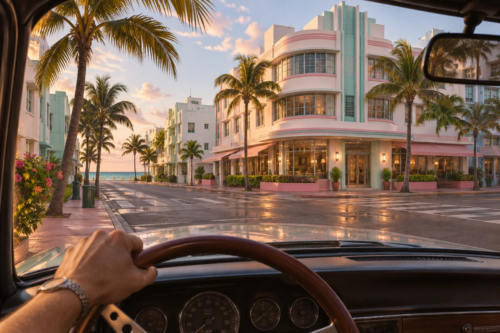
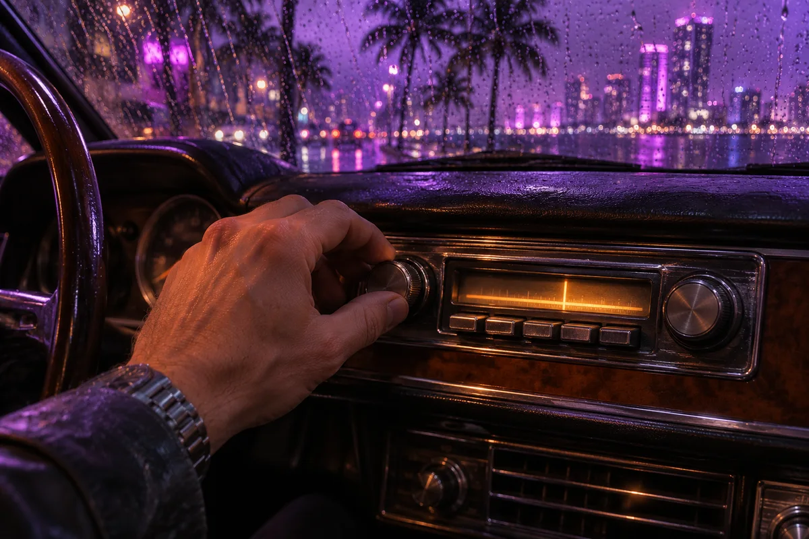
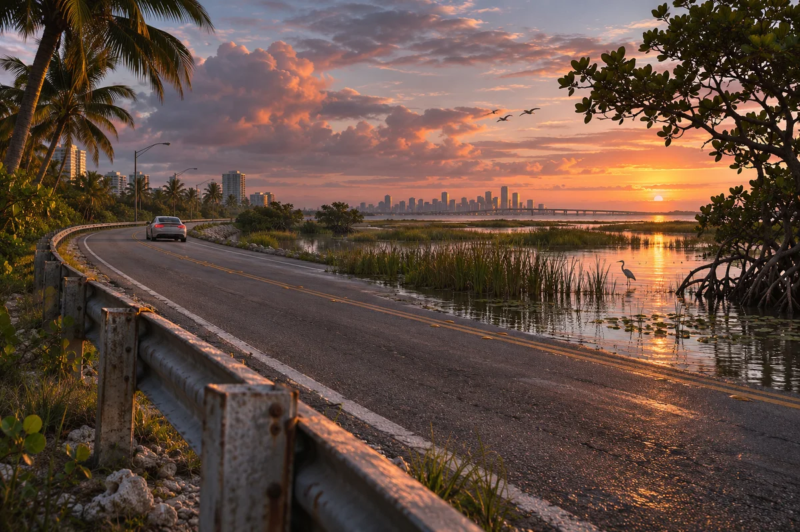

Todo mundo tem um palpite sobre a primeira coisa que você deveria fazer em GTA 6. O problema é que, depois de tanta gente apontar o caminho, você corre o risco de chegar a Vice City já sabendo para onde virar. Minha proposta é guardar o primeiro passeio para quando o jogo liberar a exploração. Entre num carro, escolha uma referência na paisagem e tente chegar lá de memória.

**GTA 6 tem lançamento marcado para 19 de novembro de 2026, no PlayStation 5 e no Xbox Series X|S.** A Rockstar ainda não anunciou data para PC. Se essa é sua plataforma, vale ler o que já se sabe e o que ainda é [estimativa sobre os requisitos de GTA 6 no PC](/requisitos-pc-gta-6-2026/). No console, dá para preparar a sala antes de abrir o jogo. O [guia de funções da smart TV](/funcoes-smart-tv-que-voce-nao-usa/) explica onde procurar o modo jogo.

## Escolha um lugar que você reconheceria de novo

Pense na primeira vez em que conseguiu voltar para casa num bairro que mal conhecia. Talvez tenha sido pela padaria da esquina, pela curva onde o ônibus vira ou pelo prédio que dá para ver de longe. Nossa memória costuma guardar esses lugares antes de decorar o nome das ruas. Dá para trazer esse hábito para Vice City.

Quando tiver liberdade para dirigir, escolha um ponto visível que desperte curiosidade. Pode ser uma avenida à beira d'água ou um prédio que se destaque no horizonte. Use o mapa para ter uma ideia da direção e tente fazer o resto olhando para a rua. Se passar direto pela entrada, dê a volta. O erro faz parte do passeio. É assim que uma rua que você jamais marcaria no mapa pode virar seu atalho favorito.

Quem jogou o Vice City de 2002 tem outra brincadeira à mão. Repare no que faz a cidade parecer familiar antes mesmo de reconhecer um lugar. Pode ser a arquitetura perto da praia, a luz num cruzamento ou uma faixa no rádio. A Vice City apresentada agora é contemporânea. A graça está em descobrir quais detalhes ainda carregam a lembrança daquela cidade antiga.

## Deixe uma estação tocar por tempo suficiente

Experimente passar um trecho inteiro na mesma estação, mesmo que a primeira música não seja a sua cara. Num jogo em que boa parte do tempo se passa entre um lugar e outro, uma faixa tem espaço para mudar a sensação de um trajeto. A música que você pularia no celular pode ser justamente a que vai lembrar daquela ponte.

A [página oficial de música de GTA 6](https://www.rockstargames.com/VI/music) permite ouvir amostras de algumas estações do jogo e separa as rádios da trilha original e do álbum. Se você quer preservar o primeiro encontro com a cidade, guarde essas prévias para depois. Na volta de carro, faça um trecho com o rádio desligado e compare o que sua atenção encontra. Talvez você passe a reparar mais no trânsito, no motor ou em algo acontecendo do outro lado da calçada.

## Saia de Vice City com uma pergunta

As primeiras imagens fizeram muita gente pensar em praia e letreiro luminoso, mas o [guia oficial de Leonida](https://www.rockstargames.com/VI/only-in-leonida) apresenta regiões com paisagens diferentes, como as ilhas de Leonida Keys e a área pantanosa de Grassrivers. Quando o jogo abrir caminho, o passeio pode continuar para além da cidade com uma pergunta simples. Em que ponto você percebe que saiu de Vice City?

Talvez a resposta apareça antes do nome do lugar na tela. Preste atenção em como mudam a distância entre os prédios, a largura da estrada e o que as pessoas parecem estar fazendo. Se a paisagem só saltasse de um cartão-postal para o outro, bastaria ver as fotos. O trabalho de um bom mundo aberto aparece também no caminho entre os pontos turísticos.

Se topar com um trecho que dá vontade de fotografar, tente voltar por ele na direção contrária. Na ida, você talvez estivesse olhando para onde a estrada acabava. Na volta, pode descobrir de onde veio a luz que chamou sua atenção. O caminho é o mesmo, mas agora você tem uma referência para descrever o lugar a um amigo sem mostrar o mapa.

## Guarde a primeira história para o grupo

Se os amigos estiverem jogando na mesma semana, combinem uma regra para o grupo de WhatsApp. Pode contar um desvio que você tomou por curiosidade, sem dizer o que acontece na campanha de Jason e Lucia. Dá para trocar histórias da primeira volta sem estragar a surpresa de quem ainda está instalando o jogo.

Antes da estreia, silencie termos específicos e evite as recomendações de vídeo se costuma receber clipes de GTA. Miniatura e título já entregam bastante, mesmo com a reprodução automática desligada. Você pode deixar mapas de colecionáveis, comparativos de desempenho e listas de segredos para a segunda sessão. A primeira tem uma vantagem que nenhuma delas oferece. Você ainda pode pegar a saída errada e descobrir, por conta própria, onde ela vai dar.

## Fontes consultadas

- [Rockstar Games, página oficial de Grand Theft Auto VI](https://www.rockstargames.com/VI)
- [Rockstar Games, guia oficial de Leonida](https://www.rockstargames.com/VI/only-in-leonida)
- [Rockstar Games, estações de rádio e trilha de GTA 6](https://www.rockstargames.com/VI/music)
- [Take-Two, calendário de lançamentos no relatório de 9 de novembro](https://www.take2games.com/ir/news/take-two-interactive-software-inc-reports-results-fiscal-4)
