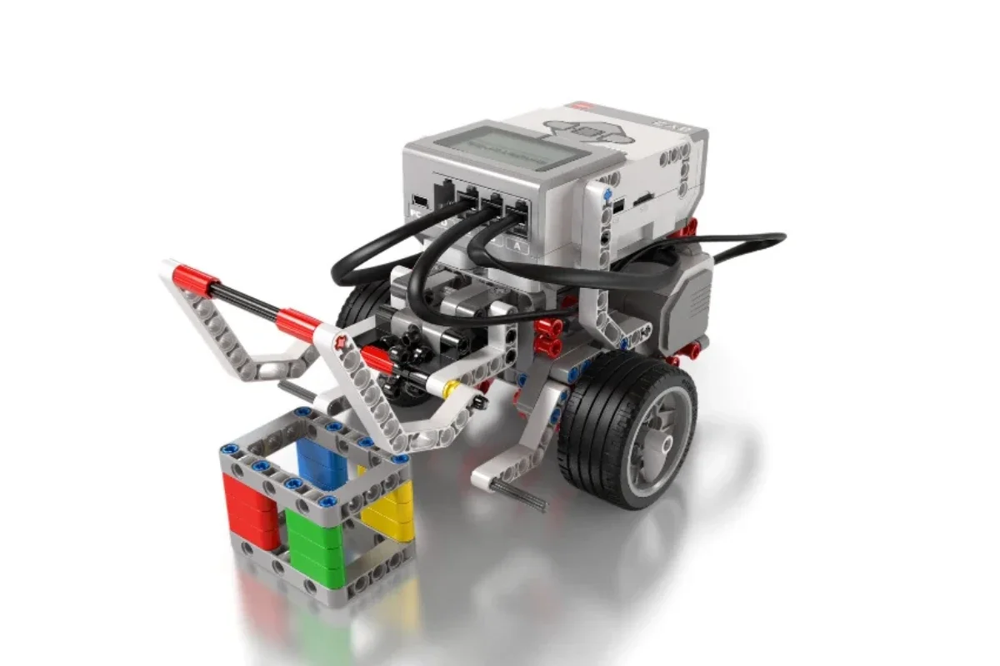
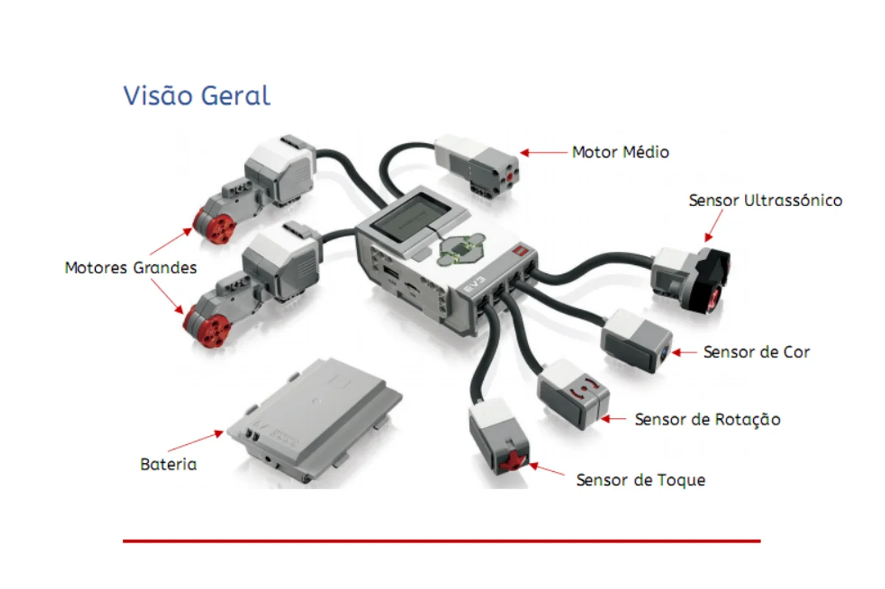
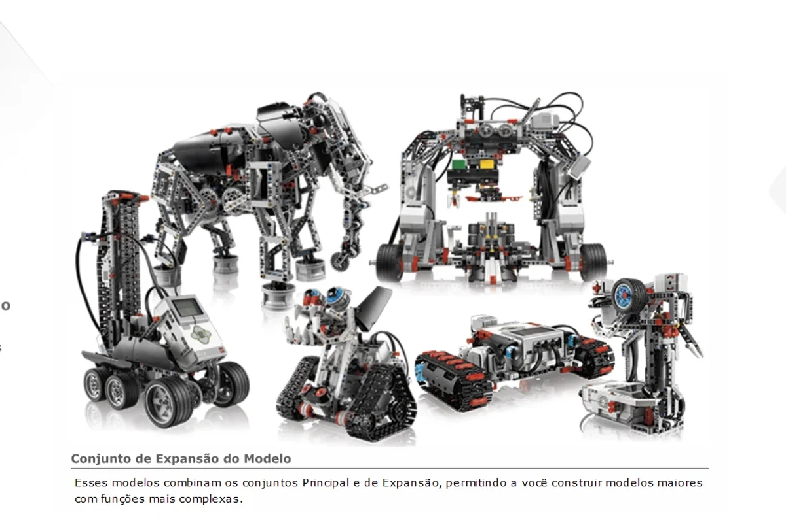
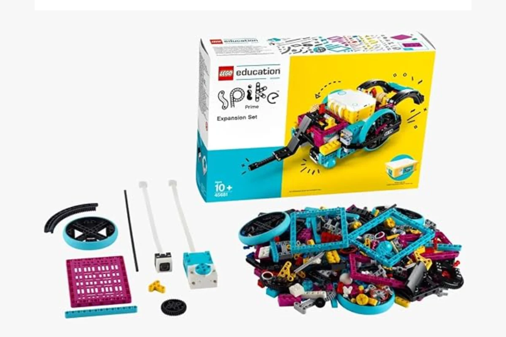
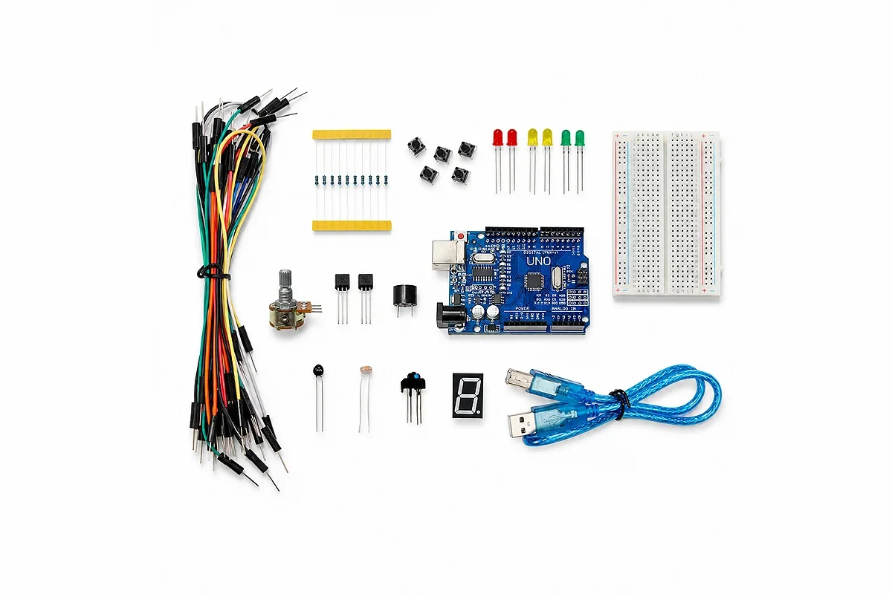

O **LEGO MINDSTORMS EV3** é um kit de robótica em que o aluno monta o robô, programa e testa. Para quem estuda pedagogia, ele mostra na prática como o pensamento computacional entra na sala de aula sem depender de aula expositiva.

Este guia apresenta o kit, uma sequência de cinco projetos de programação e a ligação de cada um com a **BNCC Computação**. Se você ainda não conhece a Base, comece por [o que é BNCC](/o-que-e-bncc/). Para o panorama das dez competências gerais, veja como a [robótica educacional trabalha as competências da BNCC](/competencias-bncc-robotica-educacional/).

## O que é o LEGO MINDSTORMS EV3

O EV3 chegou em 2013 e reúne peças de montar, motores, sensores e um pequeno computador programável. O valor pedagógico está no ciclo completo: levantar uma hipótese, montar, programar, testar, errar e ajustar. É a aprendizagem pela experiência, com resposta imediata do robô.

O kit educacional (set 45544) tem 541 peças e quatro grupos de componentes:

- **Bloco EV3 (o "cérebro"):** guarda o programa, tem tela e botões, 4 portas de entrada (sensores) e 4 de saída (motores).
- **Motores (os "músculos"):** 2 grandes, para deslocamento, e 1 médio, para movimentos menores.
- **Sensores (os "sentidos"):** toque, cor, rotação (giroscópio) e ultrassônico.
- **Bateria:** deixa o robô funcionar sem fio ligado ao computador.

Essa divisão rende uma boa conversa em sala: o robô **percebe** pelos sensores, **decide** pelo programa e **age** pelos motores. Os alunos reconhecem ali o próprio jeito de perceber, pensar e agir.

## A programação em blocos

O robô é programado no software oficial do EV3, em blocos que se encaixam, sem digitar código. Na apostila que uso como base, os blocos se dividem em cinco grupos:

- **Ação:** mover motores, tocar som, mostrar algo na tela.
- **Fluxo:** iniciar, aguardar, repetir (ciclo) e decidir (verdadeiro ou falso).
- **Sensor:** ler cor, toque, rotação e distância.
- **Dados:** variáveis, operações matemáticas e lógicas.
- **Avançados:** arquivos, mensagens e Bluetooth.

Para começar, bastam os de ação, fluxo e sensor. Os demais ficam para quando a turma pedir mais desafio.

## Cinco projetos, do mais simples ao mais completo

A apostila traz cinco projetos curtos. Eles formam uma escada de conceitos, e cada degrau se liga a uma habilidade da BNCC Computação:

| Projeto | O que o robô faz | Conceito | Habilidade BNCC |
| --- | --- | --- | --- |
| 1 | Anda duas vezes para a frente e gira um quarto de volta à esquerda | Sequência | <mark class="bncc-code">EF01CO03</mark> |
| 2 | Repete a sequência quatro vezes e desenha um quadrado | Laço (repetição) | <mark class="bncc-code">EF02CO02</mark> |
| 3 | Anda até achar um obstáculo a menos de 30 cm | Sensor ultrassônico e espera por condição | <mark class="bncc-code">EF03CO06</mark> |
| 4 | Ao achar obstáculo a menos de 20 cm, inverte o sentido e continua | Repetição com condição | <mark class="bncc-code">EF03CO02</mark> |
| 5 | Sempre que acha obstáculo a menos de 20 cm, gira à esquerda e continua | Condicional dentro de um laço | <mark class="bncc-code">EF05CO04</mark> |

O mapeamento é uma proposta de uso: a apostila não cita a BNCC, e quem faz a ligação é o professor ao planejar a aula.

## O que a BNCC Computação pede, em linguagem de sala de aula

Os códigos da tabela acima vêm do complemento de Computação à BNCC. Em resumo:

- **<mark class="bncc-code">EF01CO03</mark>:** reorganizar e criar sequências de passos, ligando-as à ideia de algoritmo.
- **<mark class="bncc-code">EF02CO02</mark>:** criar e simular algoritmos com repetições simples e perceber como a precisão da instrução muda o resultado.
- **<mark class="bncc-code">EF03CO02</mark>:** criar algoritmos com repetição condicionada, de forma independente e em colaboração.
- **<mark class="bncc-code">EF03CO06</mark>:** entender que o computador se comunica com o mundo por dispositivos de entrada e saída, como os sensores.
- **<mark class="bncc-code">EF05CO04</mark>:** combinar sequências, repetições e seleções condicionais.

Além delas, o robô ajuda a trabalhar outras habilidades que atravessam todos os projetos:

- **Decompor o problema** (<mark class="bncc-code">EF03CO03</mark>): para desenhar o quadrado, o aluno primeiro percebe que ele é feito de quatro lados iguais e quatro giros.
- **Depurar** (<mark class="bncc-code">EF07CO02</mark>, dos Anos Finais): quando o robô não faz o esperado, o aluno analisa o programa, testa e corrige.
- **Comparar soluções** (<mark class="bncc-code">EI03CO05</mark>, da Educação Infantil): grupos diferentes resolvem o mesmo desafio e comparam os caminhos.
- **Trabalhar em equipe:** as competências específicas de Computação (C4, C5 e C6 do Ensino Fundamental) falam em criar soluções de forma cooperativa, avaliar processos e desenvolver projetos baseados em problemas.

A faixa etária recomendada pelo fabricante é a partir de 10 anos. Para a Educação Infantil, o documento da BNCC Computação traz exemplos de atividades plugadas e desplugadas (sem computador), e o robô pode entrar como complemento.

## Um passo a passo de aula

Uma aula com o EV3 pode seguir sempre o mesmo roteiro, o que dá segurança ao professor e à turma:

1. **Desafio:** o professor apresenta o problema ("o robô precisa parar antes de bater na parede").
2. **Montagem:** os grupos montam o robô, dividindo funções.
3. **Programação:** os grupos escrevem o programa em blocos.
4. **Teste:** o robô roda e a turma observa o resultado.
5. **Ajuste:** quando falha, o grupo descobre o erro, corrige e testa de novo.
6. **Comparação:** os grupos mostram suas soluções e explicam o que mudaram.

O erro, nesse roteiro, deixa de ser falha e vira dado. É isso que faz a robótica diferente de uma aula tradicional.

## E as 10 competências gerais da BNCC?

Além das habilidades de Computação, a mesma aula com o EV3 trabalha várias das **competências gerais** da Base. Cada etapa do roteiro acima ativa uma delas:

| Competência geral | Onde aparece na aula com o EV3 |
| --- | --- |
| 2. Pensamento científico, crítico e criativo | Testar, observar o erro, formular uma nova hipótese e ajustar o programa |
| 4. Comunicação | Explicar à turma como o robô foi montado e programado |
| 5. Cultura digital | Programar em blocos e usar sensores e motores com um propósito |
| 7. Argumentação | Defender a solução do grupo ao compará-la com as dos colegas |
| 8. Autoconhecimento e autocuidado | Lidar com a frustração quando o robô não faz o esperado e persistir |
| 9. Empatia e cooperação | Dividir funções na montagem e ouvir as ideias do grupo |

As outras quatro (conhecimento, repertório cultural, trabalho e projeto de vida, responsabilidade e cidadania) aparecem de forma mais indireta e dependem do desafio proposto. Para ver as dez com exemplos por etapa de ensino, leia o guia sobre como a [robótica educacional trabalha as competências da BNCC](/competencias-bncc-robotica-educacional/).

## Indo além com o kit de expansão

Quando a turma domina o kit principal, o Conjunto de Expansão soma mais peças e permite robôs maiores e mais complexos, como o elefante, os robôs de esteira, o pórtico e o braço articulado.

A variedade mostra a ideia central do kit: as mesmas peças viram um animal, um veículo ou uma máquina, dependendo do problema. Dois grupos podem receber o mesmo desafio e chegar a robôs completamente diferentes, e comparar as soluções vira parte da aula.

## O EV3 saiu de linha

A LEGO Education encerrou a linha EV3 e indica o SPIKE Prime como sucessor. Mesmo assim, muitas escolas e laboratórios ainda têm o kit, e os conceitos que ele ensina (sequência, repetição, condição, medição) valem para qualquer plataforma de robótica que venha depois. Quem ainda usa o EV3 encontra a documentação dos blocos e dos sensores na [ajuda online oficial da LEGO Education](https://ev3-help-online.api.education.lego.com/Education/hu-hu/index.html).

## Além do EV3: SPIKE Prime e Arduino

O EV3 não é o único kit que uso. Trabalho também com o **Conjunto de Expansão do LEGO Education SPIKE Prime** e com um **kit de Arduino**. Cada um mostra um lado diferente da computação.

### SPIKE Prime: o sucessor do EV3

O Conjunto de Expansão do SPIKE Prime complementa o kit principal com mais peças, para montar modelos maiores e mais variados. A indicação do fabricante também é a partir de 10 anos, e a lógica de aula é a mesma do EV3: montar, programar, testar e ajustar.

A diferença está nas peças, mais compactas e coloridas, e no ambiente de programação, que combina blocos e Python. Para o professor, é o caminho natural de quem já domina o EV3 e quer atualizar o material.

### Arduino: a computação por dentro

O kit de Arduino muda o foco. Em vez de um robô de montar, o aluno monta um **circuito** com a placa, a protoboard, LEDs, botões, resistores, buzzer, sensores de luz e temperatura, display de 7 segmentos e cabos.

Um projeto simples é o **semáforo**: três LEDs acendem em sequência (vermelho, verde e amarelo), com tempo de espera entre cada cor. Com um botão de pedestre, o semáforo passa a ter uma condição. Isso trabalha as mesmas ideias do EV3, como sequência, repetição e seleção condicional (<mark class="bncc-code">EF05CO04</mark>), e reforça a noção de dispositivos de entrada e saída (<mark class="bncc-code">EF03CO06</mark>). Aqui o aluno vê a eletrônica que fica escondida dentro do robô pronto.

### Qual kit escolher

| Kit | O que o aluno faz | Programação | Combina melhor com |
| --- | --- | --- | --- |
| LEGO EV3 | Monta e programa um robô com motores e sensores | Blocos | Projetos de robô e desafios em grupo |
| LEGO SPIKE Prime | Monta e programa robôs com peças mais novas | Blocos e Python | Escolas que querem atualizar o material |
| Arduino | Monta circuitos com LEDs, botões e sensores | Código (Arduino IDE) | Turmas mais velhas, com foco em eletrônica |

Não existe kit certo para todas as turmas. A escolha depende da idade, do tempo de aula e do que o professor quer ensinar: robô, circuito ou os dois.

## Perguntas frequentes

**Preciso saber programar para usar o EV3 em sala?**
Não. A programação é em blocos, e os cinco projetos da apostila servem de ponto de partida para o professor aprender junto com a turma.

**Em que ano escolar o EV3 funciona melhor?**
O fabricante recomenda a partir de 10 anos. Nos anos anteriores, vale começar com atividades desplugadas e usar o robô apenas como demonstração.

**O EV3 ainda vale a pena, se foi descontinuado?**
Para quem já tem o kit, sim. Os conceitos são os mesmos de plataformas mais novas, e a escolha de comprar ou não um sucessor fica para depois.

## Conclusão

O LEGO MINDSTORMS EV3 transforma habilidades abstratas da BNCC Computação, como algoritmo, repetição e condição, em algo que o aluno vê e corrige com as próprias mãos. Para o futuro professor, o essencial é planejar o desafio e conduzir a comparação das soluções, e não dominar a máquina.

Para ampliar a discussão sobre tecnologia e currículo, leia também [IA nas escolas e BNCC Computação](/ia-nas-escolas-bncc-computacao-professores/).

## Fontes consultadas

Manual de Iniciação LEGO MINDSTORMS EV3 (apostila de sala de aula) | BNCC Computação, complemento à BNCC (Parecer CNE/CEB nº 2/2022) | LEGO Education, comunicado de fim de ciclo do EV3
