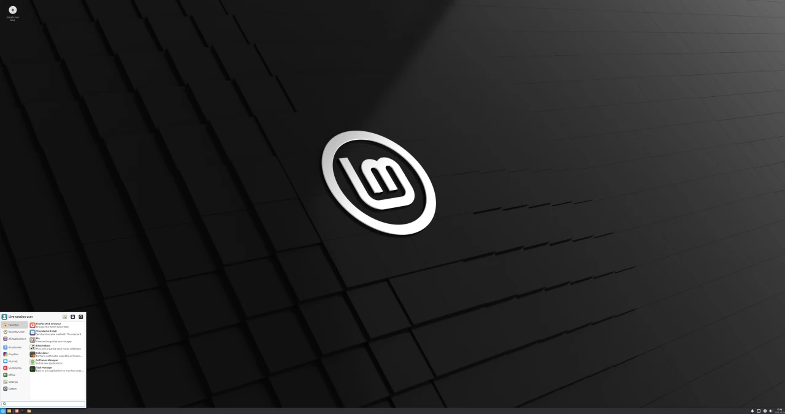
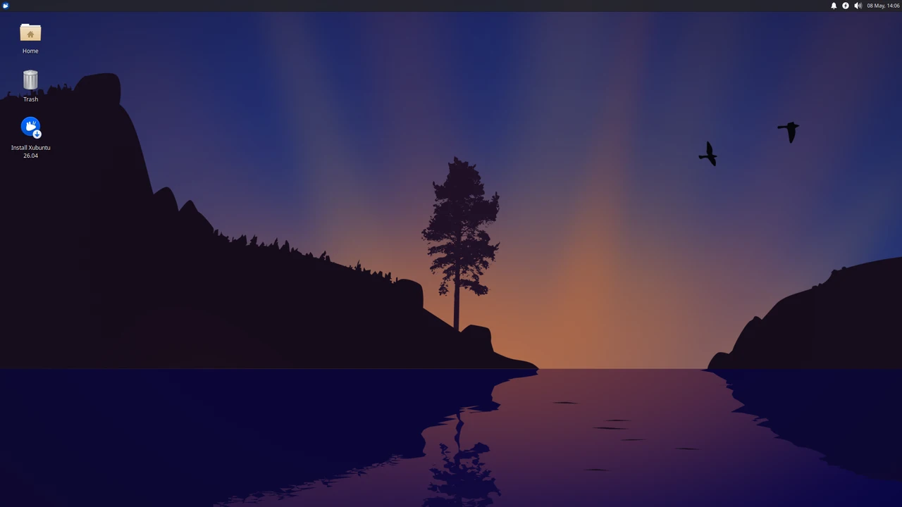
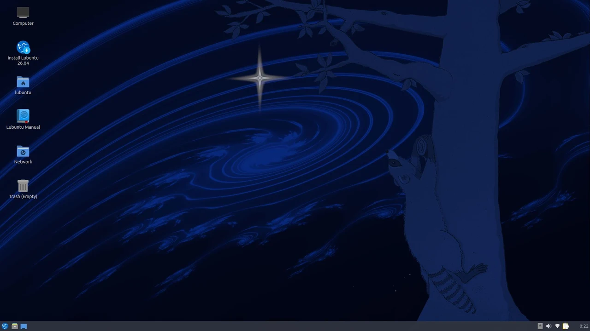

O notebook antigo ainda liga, mas abrir o navegador virou um teste de paciência. Antes de comprar outro, dá para descobrir se ele ainda serve para estudar, escrever ou fazer uma videochamada. O jeito mais simples de tirar a dúvida é iniciar uma distribuição Linux pelo pendrive e repetir as tarefas que você já faz no Windows.

**Comece pelo Linux Mint Xfce** se você quer um menu familiar e uma área de trabalho leve. O **Xubuntu** é uma alternativa para quem prefere o ecossistema Ubuntu com Xfce. O **Lubuntu** vale entrar na comparação quando você quer experimentar um desktop mais enxuto, o LXQt. Para decidir, abra o mesmo vídeo, as mesmas abas e um arquivo seu em cada sistema que testar.

Se você ouviu falar de Linux pela primeira vez agora, vale conhecer [o que muda de uma distribuição para outra](/linux/). Se a lentidão apareceu junto com um aviso de disco cheio, veja também [como liberar espaço no Windows](/limpar-arquivos-temporarios-windows/). Identificar quando a máquina engasga ajuda a escolher o que testar.

## Qual distribuição Linux vale testar primeiro?

| Se a prioridade é… | Comece por | O que observar |
| --- | --- | --- |
| Encontrar menus e arquivos sem reaprender o básico | Linux Mint Xfce | Se você consegue localizar aplicativos, configurações e arquivos com facilidade |
| Usar a base Ubuntu com um desktop mais simples | Xubuntu LTS | Se o Xfce atende à rotina e os periféricos funcionam |
| Experimentar um ambiente gráfico mais enxuto | Lubuntu LTS | Se ainda sobra fôlego para o navegador com as abas que você costuma abrir |

### Linux Mint Xfce para quem vem do Windows

O Mint Xfce é um bom primeiro teste se você quer se orientar pelo menu de aplicativos, pelo painel e pelo gerenciador de arquivos. **Xfce é o nome da interface que você vê na tela.** O projeto Linux Mint oferece também a edição Cinnamon, com mais recursos visuais. Para um notebook que já sente o peso do sistema atual, a edição Xfce é o ponto de partida mais interessante entre as duas.

*Linux Mint 22.2 Xfce. O menu de aplicativos fica no canto inferior esquerdo. Captura de Clement Lefebvre.*

Teste o que você costuma fazer sem pensar. Abra a pasta de downloads, conecte o fone e altere o brilho. Se essas ações fluírem e o navegador der conta da sua rotina, você já tem uma candidata para o uso diário.

### Xubuntu LTS para usar a base Ubuntu com Xfce

O Xubuntu é uma edição oficial do Ubuntu que usa Xfce. A interface segue a mesma proposta de leveza do Mint Xfce, com as escolhas de aplicativos, painel e configurações do próprio Xubuntu. Uma edição LTS tem suporte de longo prazo. Confira o prazo da versão escolhida na página oficial de download.

*Xubuntu 26.04 LTS. O painel do Xfce fica no topo da tela. Captura da equipe Xubuntu.*

Como as duas opções usam Xfce, dê mais peso ao que perceber no seu notebook. Veja qual se conecta ao Wi-Fi, retoma depois de fechar a tampa e reconhece seus acessórios. Essas diferenças pesam mais no uso diário do que a aparência da tela inicial.

### Lubuntu LTS para experimentar o LXQt

O Lubuntu também faz parte da família Ubuntu. Sua interface é o **LXQt**, que tem menus simples e poucos efeitos visuais. Vale testá-lo quando o notebook demora a responder até em ações básicas, como trocar entre duas janelas.

*Lubuntu 26.04 LTS. O painel do LXQt fica na parte inferior da tela. Captura da equipe Lubuntu.*

Em um aparelho com 4 GB de RAM, por exemplo, coloque o navegador à prova antes de decidir. Abra os sites que você usa juntos e rode um vídeo na qualidade que costuma assistir. Se a máquina só engasga durante a reprodução, o gargalo pode estar na decodificação do vídeo. Se o problema aparece ao acumular abas e aplicativos, a memória pode estar no limite.

## Como testar pelo pendrive sem apagar o Windows

Você vai precisar de um pendrive que possa ser apagado. **Criar a mídia de teste apaga o conteúdo do pendrive.** A sessão de teste roda pelo USB. Para manter o disco interno intacto, evite abrir o instalador ou alterar partições e arquivos do disco.

1. **Confira o processador.** No Windows, vá a **Configurações → Sistema → Sobre** e procure o tipo de sistema. As imagens de PC indicadas aqui são para processadores Intel ou AMD de 64 bits.
2. **Baixe a imagem ISO no site oficial.** Para começar pelo Mint, escolha a edição Xfce na [página oficial do Linux Mint](https://linuxmint.com/download.php). As outras opções estão nas fontes ao fim do artigo.
3. **Grave a ISO e reinicie pelo USB.** No Windows, um gravador como o Rufus prepara o pendrive inicializável. Selecione o dispositivo com atenção. A tecla para abrir o menu de inicialização varia conforme a marca do notebook.
4. **Entre na sessão de teste.** Procure a opção de experimentar o sistema quando ela for exibida. No Mint, a sessão inicia pelo USB, com um atalho para instalar na área de trabalho. Deixe o instalador fechado.
5. **Reproduza sua rotina.** Conecte o Wi-Fi, abra suas abas, reproduza um vídeo e confira teclado, touchpad, som e webcam. Se usa monitor externo, impressora ou fone Bluetooth, experimente esses acessórios também.

Quando terminar, desligue o notebook, retire o pendrive e volte a ligar. Se você apenas usou a sessão de teste, o Windows continua no disco. A leitura pelo USB pode ser mais lenta que em uma instalação. Use a sessão para avaliar compatibilidade e testar a própria rotina.

## Quando vale instalar de vez?

Se as tarefas que você precisa fazer funcionaram, confira o último ponto antes de migrar. Seu trabalho depende de algum programa exclusivo do Windows? Abra uma cópia de um documento real e teste o que precisa manter, como formatação, macros ou assinatura digital. Para jogos, verifique cada título que importa para você, especialmente se usa um sistema antitrapaça.

Se as três distribuições tropeçarem na mesma tarefa, investigue o gargalo antes de formatar. Para um notebook que ainda usa HD mecânico, vale verificar se ele aceita um SSD. Se você precisa manter um aplicativo do Windows, pode continuar usando o sistema atual e deixar o pendrive como opção de teste. Se decidir instalar Linux, faça backup dos arquivos e confirme que consegue abri-los em outro dispositivo antes de mexer nas partições.

## Fontes consultadas

- [Edições e download oficial do Linux Mint](https://linuxmint.com/download.php)
- [Guia de instalação do Linux Mint](https://linuxmint-installation-guide.readthedocs.io/en/latest/install.html)
- [Download e requisitos do Xubuntu](https://xubuntu.org/download/)
- [Guia de instalação do Xubuntu](https://docs.xubuntu.org/user/C/installation.html)
- [Lubuntu LTS e ambiente gráfico LXQt](https://lubuntu.me/downloads/)

As capturas foram redimensionadas e convertidas para WebP. Os originais estão no Wikimedia Commons sob a [licença GNU GPL v2 ou posterior](https://www.gnu.org/licenses/old-licenses/gpl-2.0.html).

- [Captura original do Linux Mint 22.2 Xfce](https://commons.wikimedia.org/wiki/File:Linux_Mint_22.2_XFCE_eng.webp)
- [Captura original do Xubuntu 26.04 LTS](https://commons.wikimedia.org/wiki/File:Xubuntu_26.04_LTS_default_desktop_-_English.png)
- [Captura original do Lubuntu 26.04 LTS](https://commons.wikimedia.org/wiki/File:Lubuntu_26.04_LTS_default_desktop_-_English.jpg)
