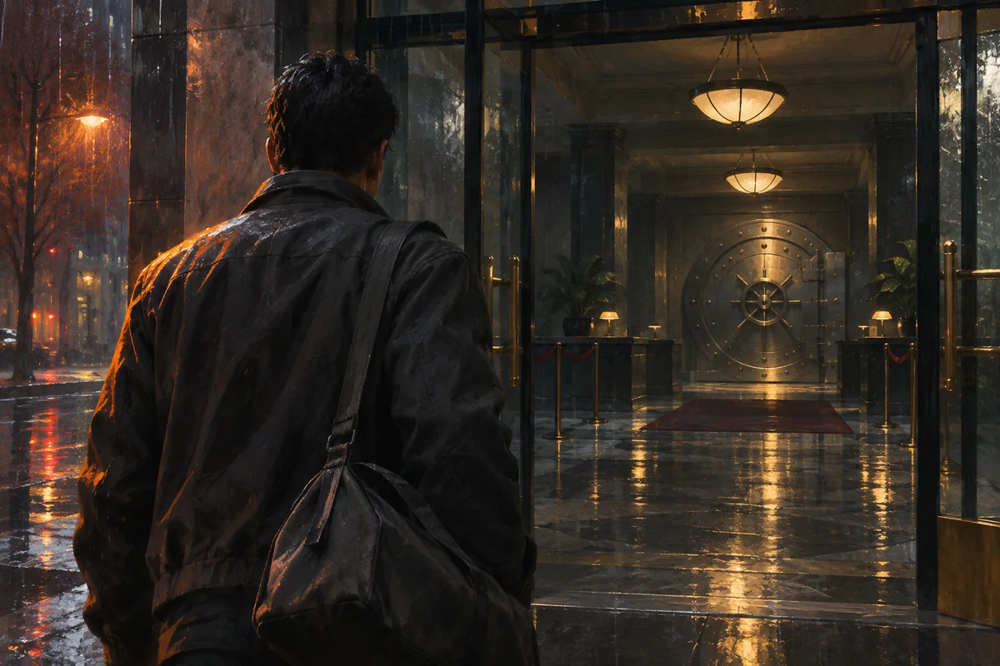

Um roubo que parecia fácil dá errado, e Jason Duval e Lucia Caminos acabam no meio de uma conspiração que atravessa o estado de Leonida. Os dois são os protagonistas jogáveis de **GTA 6**, mas entender o que está em jogo para o casal passa por conhecer quem já faz parte da vida deles e quem tem seus próprios planos em Vice City.

Este guia reúne os **nove personagens que a Rockstar destaca na apresentação de Leonida**, incluindo as duas integrantes da Real Dimez. A análise parte das biografias oficiais e da premissa da campanha, sem spoilers das missões. A capa vem da Rockstar Games, e as imagens das seções são ilustrações editoriais geradas por IA, inspiradas no papel de cada personagem.

Se você quer conhecer a cidade no seu ritmo, veja o [guia do primeiro passeio em Vice City](/gta-6-primeiro-passeio-vice-city/). Para escolher onde jogar, o [comparativo de GTA 6 no PlayStation e no Xbox](/gta-6-60-fps-ps5-pro/) explica o que muda de um console para outro.

## Jason Duval quer sair da vida que conhece

Jason cresceu cercado de golpistas e passou pelo Exército antes de trabalhar para traficantes em Leonida Keys. Ele quer uma vida mais tranquila. Por enquanto, o trabalho com Brian Heder é o que lhe garante um teto. Jason mora de graça numa propriedade do contrabandista em troca de ajudar em cobranças locais.

Essa troca explica por que mudar de vida custa caro para Jason. Sair significa abrir mão de um lugar para morar e dos contatos que lhe dão trabalho. A relação com Lucia põe essa escolha no centro da história. A vida que os dois imaginam juntos exige que ele arrisque a estabilidade que já tem.

## Lucia Caminos quer escolher como vai viver

Lucia aprendeu a lutar com o pai e foi parar na penitenciária de Leonida depois de defender a família. Quando sai, tem um objetivo. Ela quer conquistar a vida que a mãe imaginava desde os tempos em Liberty City e vê em Jason a possibilidade de construir esse futuro junto com alguém.

O passado de Lucia dá peso à liberdade que ela tem no começo da história. Uma decisão tomada em nome da família já lhe custou essa liberdade uma vez. Agora, os planos dela partem de uma vontade concreta de escolher o que vem a seguir. Para Jason, a parceria abre uma saída. Para Lucia, a parceria faz parte de um plano para recomeçar.

## Brian Heder faz favores que cobram um preço

Brian é um veterano do contrabando nas Keys. Ele e a esposa, Lori, ainda usam o estaleiro para movimentar mercadoria, e Brian se apoia em associados como Jason para cuidar de serviços locais.

A casa que ele oferece a Jason ajuda a explicar o alcance desse poder. Um favor pode resolver uma necessidade imediata e, ao mesmo tempo, deixar quem o recebe disponível para o próximo serviço. Brian mostra como essas relações se sustentam em Leonida Keys mesmo quando ninguém está falando de um grande golpe.

## Cal Hampton prefere ficar perto do rádio

Cal é amigo de Jason e também faz parte do círculo de Brian. Em casa, gosta de bisbilhotar as comunicações da Guarda Costeira e se diverte com teorias que fazem até uma formação de pássaros parecer suspeita.

A paranoia rende humor, mas é a amizade com Jason que dá sentido a Cal no elenco. Os dois conhecem o mesmo círculo e encaram a vida nas Keys de jeitos diferentes. Cal se sente à vontade na rotina que Jason considera pequena demais para os seus planos.

## Raul Bautista aumenta o risco de cada assalto

Raul é um assaltante de bancos experiente que procura gente disposta a topar as operações mais arriscadas. Seu charme ajuda a conquistar a confiança da equipe. A imprudência, destacada pela Rockstar, explica por que essa confiança pode sair cara.

Com Raul, o risco do assalto começa na hora de decidir se vale a pena aceitar o trabalho. Quanto maior a recompensa prometida, mais difícil fica para a equipe perceber quando chegou a hora de recuar.

## Boobie Ike investe o dinheiro das ruas na vida noturna

Boobie é conhecido em Vice City por transformar o dinheiro do crime em negócios que vão de imóveis a uma boate e um estúdio. Na Only Raw Records, ele aposta no talento de Dre’Quan Priest para a gravadora emplacar um sucesso.

Boobie ajuda a explicar onde o crime e a cena musical se encontram em Vice City. A boate gera dinheiro e oferece espaço para artistas. O estúdio dá a esse negócio a chance de produzir algo que circule pela cidade inteira.

## Dre’Quan Priest aposta no próximo sucesso de Vice City

Dre’Quan já vendia drogas para se sustentar enquanto tentava entrar no ramo da música. Ele passou a agendar atrações para a boate de Boobie e, com a Only Raw Records, ganhou a chance de apostar em artistas próprios. A contratação das Real Dimez é o passo mais importante desse plano apresentado pela Rockstar.

Dre’Quan investe numa habilidade que já usava na boate, a de perceber o que pode pegar com o público. A diferença é que, com a gravadora, a carreira dele também passa a depender do que acontece com as artistas depois que a música sai do estúdio.

## Bae-Luxe leva a história das Real Dimez para o microfone

Bae-Luxe forma as Real Dimez com Roxy Rashad, sua amiga desde o ensino médio. As duas levaram para as letras experiências que tiveram nas ruas e ganharam projeção com uma faixa gravada com o rapper DWNPLY. Agora, querem repetir o sucesso pela Only Raw Records.

O passado que Bae-Luxe divide com Roxy é parte do que dá identidade à dupla. Com elas, a música em GTA 6 também conta a história de gente que usa as próprias experiências para conquistar público em Vice City.

## Roxy Rashad divide a aposta da dupla nas redes

Roxy é a outra voz das Real Dimez. A Rockstar apresenta as duas como parceiras tanto nas faixas quanto na divulgação pelas redes sociais. O contrato com a gravadora chega quando elas já sabem o que é ter um hit e precisam provar que conseguem manter o interesse do público.

A trajetória das duas traz para Vice City uma pergunta familiar fora do jogo. Depois que uma música viraliza, o que faz as pessoas voltarem para ouvir a próxima? A resposta interessa tanto a Roxy e Bae-Luxe quanto à gravadora que apostou nelas.

## Fontes consultadas

- [Rockstar Games, anúncio de lançamento e sinopse de GTA 6](https://www.rockstargames.com/newswire/article/39akk424a9oo53/grand-theft-auto-vi-now-available)
- [Rockstar Games, perfis oficiais dos personagens de Leonida](https://www.rockstargames.com/VI/only-in-leonida)
- [Rockstar Games, créditos oficiais de GTA 6](https://www.rockstargames.com/VI/credits)
- [Rockstar Games, galeria com a arte de capa oficial](https://www.rockstargames.com/VI/media/artwork-wallpapers)
