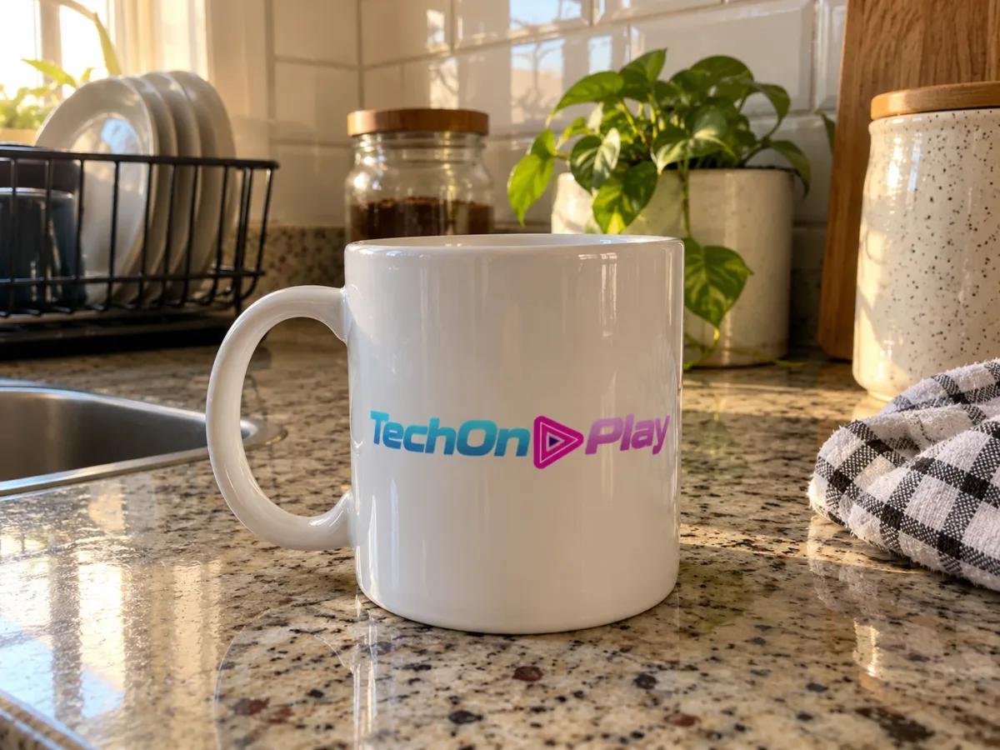
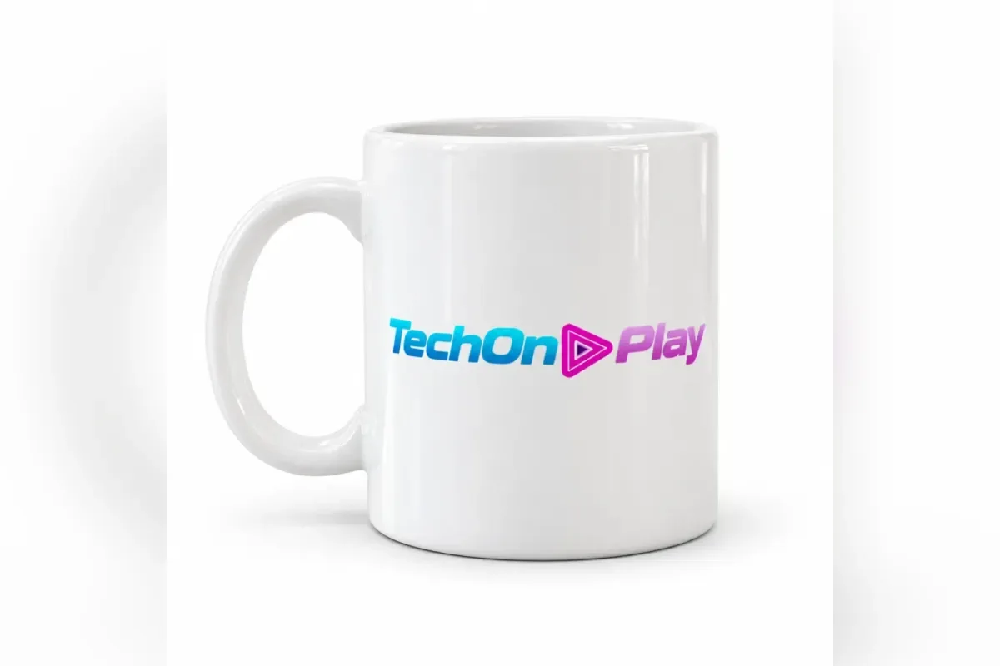
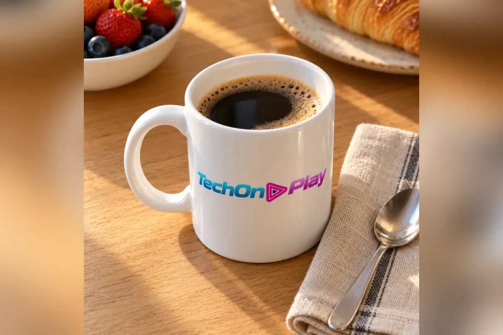
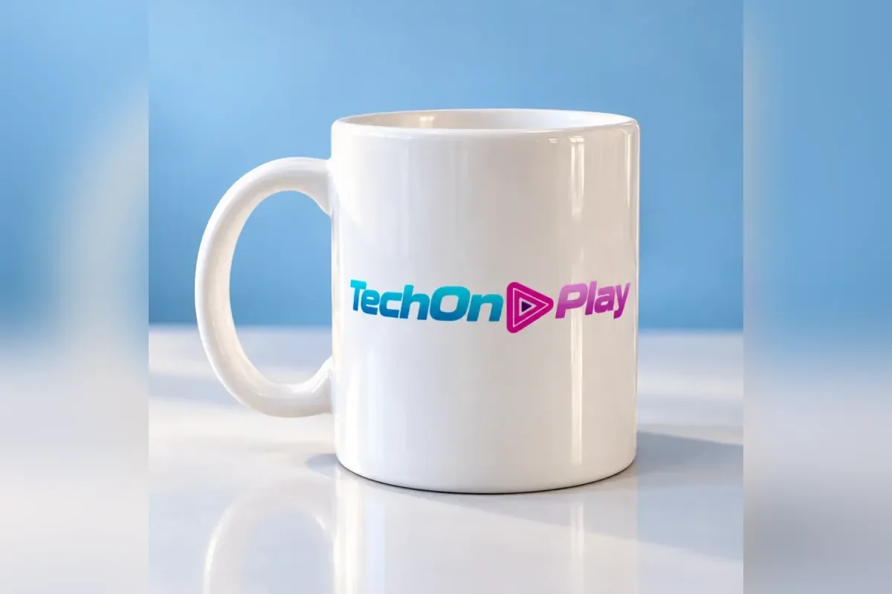

Se você vende pela internet, sabe que a foto decide boa parte da venda. Um **prompt para foto de produto no ChatGPT** serve para pegar aquela foto tirada no celular, em cima da bancada da cozinha, e transformá-la em uma imagem de catálogo, de anúncio ou de rede social, sem contratar estúdio. O princípio é o mesmo dos [comandos do ChatGPT para editar fotos](/comandos-chatgpt-editar-fotos/): você envia a imagem e diz o que mudar e o que manter.

Este guia é para iniciante e para pequeno comércio. São 8 cenários com prompt completo para copiar, e a lista maior de atalhos de imagem fica nos [100 comandos do ChatGPT](/comandos-do-chatgpt/). **Testei quatro cenários no ChatGPT** com uma caneca de exemplo e mostro o resultado logo abaixo do prompt; os outros quatro estão marcados como não testados e valem como ponto de partida. Nenhum resultado é de produto real à venda: a caneca, com o logotipo do TechOnPlay, e a foto de partida foram criadas por IA. Os testes foram feitos em 22/10/2026, e não registrei qual versão do modelo gerou cada imagem. O resultado muda de uma tentativa para outra.

## Qual IA usar e onde colar o prompt

O caminho principal é o **ChatGPT**, no aplicativo ou no navegador. O **Gemini** também aceita foto, mas neste artigo não o testei, então o resultado pode ser diferente. Para iniciantes, o passo a passo é este:

1. Abra o ChatGPT (ou o Gemini).
2. Envie a foto do produto: no ChatGPT, pelo clipe de papel; no Gemini, pelo botão "+".
3. Cole o prompt na caixa de texto, junto com a foto, e envie.
4. Olhe o resultado com atenção e, se algo estiver errado, peça o ajuste na mesma conversa.

A conta gratuita costuma ter limite diário de imagens, e o [ChatGPT grátis ou pago](/chatgpt-gratis-ou-pago/) explica o que muda entre os planos. Os limites mudam com o tempo.

### A foto de partida

Nos exemplos, o produto é uma caneca branca com o logotipo do TechOnPlay, numa bancada de cozinha com planta, pote de vidro e escorredor ao fundo. Esta é a foto que enviei ao ChatGPT em todos os testes:



Ela ficou mais caprichada do que uma foto de celular comum, com boa luz e cenário arrumado, então a diferença entre o antes e o depois aqui é mais suave do que seria com uma foto feita às pressas. O que importa para o teste é que a caneca e o logotipo estão nítidos: dá para conferir se a IA os preservou. Nos exemplos, troque "caneca" pelo seu produto.

## A regra que vale para todos os cenários

Antes dos prompts, uma fórmula que a Canaltech, em reportagem de 4 de junho de 2026, também recomenda: dizer **o que editar, onde a imagem será usada, o que não pode mudar e o formato**. Em prompts de produto, o "não pode mudar" é o mais importante. A IA redesenha a imagem inteira, e é comum alterar a cor, o rótulo ou a proporção sem aviso.

Por isso toda frase abaixo traz "preserve a caneca e o logotipo". Se o seu produto não tem logotipo, apague essa parte. Se você vende algo em que a cor real importa, como roupa ou cosmético, a linha de preservar não pode faltar.

## Os 8 cenários prontos

A tabela resume cada cenário e mostra quais eu testei. Cada prompt fica numa caixa com botão de copiar. As imagens do ChatGPT vieram quadradas ou em 4:3; para seguir o padrão de imagens do blog (3:2), as laterais das quadradas foram preenchidas com um desfoque do próprio fundo, e as de 4:3 tiveram um pequeno corte em cima e embaixo.

| Cenário | Bom para | Testei |
|---|---|---|
| Fundo branco | Marketplace, miniatura de busca | Sim |
| Fundo neutro premium | Loja própria, Instagram | Não |
| Lifestyle | Mostrar o produto em uso | Sim |
| Mesa de madeira | Artesanato, comida, papelaria | Sim |
| Embalagem | Presente, kit, unboxing | Não |
| Foto de venda | Página de produto de loja própria | Sim |
| Post de Instagram | Feed e capa de Reels | Não |
| Anúncio pago | Tráfego pago | Não |

### 1. Fundo branco para marketplace

O fundo branco facilita a leitura em miniaturas. Cada plataforma tem suas regras de imagem, e algumas categorias aceitam cenário, então confira a página de requisitos antes de enviar.

```prompt
Use a foto anexa e crie uma imagem de catálogo desta caneca com fundo branco liso e luz uniforme, formato quadrado. Preserve o produto: mesma cor, mesma forma, mesma alça e o logotipo exatamente como está, sem alterar letras nem cores. Não adicione nenhum outro texto, selo ou logotipo.
```

**Resultado no ChatGPT:**



O ChatGPT devolveu uma imagem quadrada, com a caneca centralizada sobre fundo branco liso. A forma, a alça à esquerda e as letras do logotipo (TechOn, o símbolo de play e Play) parecem iguais às da foto de partida. Dois detalhes: quase não há sombra sob a caneca, o que dá o aspecto de "recorte" comum em catálogo, e o "Play" ficou num rosa-lilás um pouco mais claro do que na foto de partida. Se quiser a caneca mais "apoiada", peça uma sombra suave no ajuste.

### 2. Fundo neutro premium

Para loja própria e redes sociais, um fundo off-white ou bege passa mais cuidado do que o branco puro. Este cenário não foi testado.

```prompt
Use a foto anexa e coloque esta caneca sobre um fundo neutro off-white, com luz suave de janela e sombra discreta. Preserve a caneca e o logotipo exatamente como estão, sem alterar cor, textura ou proporção.
```

### 3. Lifestyle, com o produto em uso

Mostre o produto no contexto em que ele é usado. O cenário deve valorizar a caneca, não competir com ela.

```prompt
Use a foto anexa e mostre esta caneca sobre uma mesa de café da manhã, com pão e frutas desfocados ao fundo, luz natural da manhã. A caneca é o foco da imagem. Preserve a caneca e o logotipo exatamente como estão.
```

**Resultado no ChatGPT:**


A caneca ficou em foco no centro, sobre uma mesa de madeira com tapete trançado, e a janela aparece desfocada ao fundo. Pedi pão e frutas, e vieram também suco de laranja, croissants e geleia, que a IA acrescentou por conta própria. A caneca e o logotipo parecem fiéis: mesma alça, mesmas letras e mesmas cores, com a luz da janela refletindo no esmalte.

### 4. Mesa de madeira, vista de cima

Funciona bem para artesanato, comida e papelaria. Num produto com o logotipo na lateral, como a caneca, pedi um ângulo inclinado em vez de vista totalmente de cima, para que o logotipo continuasse visível.

```prompt
Use a foto anexa e recrie a cena vista de cima, em ângulo inclinado de cerca de 45 graus, com a caneca sobre uma mesa de madeira clara, um guardanapo de linho e uma colher ao lado. O logotipo deve continuar visível. Poucos objetos, sem poluir. Preserve a caneca e o logotipo exatamente como estão.
```

**Resultado no ChatGPT:**



A cena ficou vista de cima, em ângulo inclinado, sobre madeira clara, com o guardanapo de linho e a colher de metal ao lado, como pedi. Mas a IA também colocou **café dentro da caneca**, uma tigela de frutas vermelhas e um prato com croissant, apesar do "poucos objetos". E o logotipo, que fica na lateral da caneca, acompanhou a curva e a perspectiva: continua legível e com as letras certas, mas ficou inclinado, com o "Play" subindo. Se o logotipo precisa aparecer reto, prefira o ângulo de frente.

### 5. Embalagem e presente

Útil para quem vende kits e quer mostrar o produto pronto para presentear. Este cenário não foi testado.

```prompt
Use a foto anexa e mostre esta caneca ao lado de uma caixa de presente de papel kraft, amarrada com barbante, sobre uma bancada clara. Sem texto e sem logotipo na caixa. Preserve a caneca e o logotipo exatamente como estão.
```

### 6. Foto de venda para loja online

É a foto de destaque da página do produto: a caneca no centro, com fundo de estúdio colorido e uma superfície clara. Diferente do fundo branco de marketplace, ela já tem cara de loja própria.

```prompt
Use a foto anexa e crie uma foto de venda desta caneca para a página de uma loja online: caneca no centro, levemente de lado, em ângulo de câmera ligeiramente baixo, sobre uma superfície clara com sombra suave e reflexo discreto, contra um fundo de estúdio liso em tom azul-claro, com luz suave e uniforme, formato quadrado. O logotipo deve ficar de frente e bem visível. Preserve a caneca e o logotipo exatamente como estão: mesma cor, mesma alça, mesmas letras e mesmas cores do logotipo. Não adicione nenhum outro texto, selo, preço ou logotipo.
```

**Resultado no ChatGPT:**



A caneca ficou no centro, com a alça à esquerda, sobre uma superfície clara e brilhante com reflexo suave, contra um fundo azul-claro liso. O logotipo está de frente e nítido, sem texto, preço ou selo a mais. A forma e a alça parecem iguais às da foto de partida, e o "Play" voltou a ficar um pouco mais claro que no original. O azul-claro foi escolha minha, por combinar com o ciano do logotipo: troque a cor no prompt pela que combinar com a sua marca.

### 7. Post de Instagram

Pedir o formato no prompt evita corte depois. O espaço livre serve para você colocar o texto no Canva ou no editor que usar. Este cenário não foi testado.

```prompt
Use a foto anexa e adapte a imagem para um post vertical 4:5 de Instagram, com espaço livre na parte de cima para texto que vou inserir depois. Preserve a caneca e o logotipo e não escreva mais nada na imagem.
```

### 8. Anúncio pago

O anúncio precisa chamar atenção em poucos segundos. Preço e promessa entram depois, na ferramenta de design, porque a IA costuma errar texto. Este cenário não foi testado.

```prompt
Use a foto anexa e crie uma imagem para anúncio: caneca em destaque, fundo simples com uma cor quente, bastante espaço vazio nas laterais. Sem texto, sem preço e sem selos. Preserve a caneca e o logotipo.
```

## O que esses testes ensinam

- **"Preserve o produto e o logotipo" funcionou nos quatro testes.** A forma, a alça e as letras do logotipo ficaram fiéis. O que variou foi o tom do "Play", um pouco mais claro em dois resultados, e a perspectiva do logotipo no ângulo inclinado.
- **A IA acrescenta o que você não pediu.** Vieram suco, croissants e geleia no lifestyle, e café e frutas na mesa de madeira. Se quer a cena limpa, diga "sem outros objetos".
- **O ângulo mexe no logotipo.** De frente, ele fica reto e fiel; em ângulo inclinado, acompanha a curva e pode ficar torto.
- **Fundo branco quase sem sombra parece recorte.** Peça uma sombra suave se quiser a caneca "apoiada".
- **Confira sempre com a original.** O teste é de uma caneca e de um conjunto de prompts: com o seu produto, o resultado pode ser diferente.

## Não ficou como queria? Peça o ajuste

Responda na mesma conversa, com uma correção por vez:

```prompt
A cor da caneca saiu diferente da foto original. Refaça mantendo exatamente a cor da foto que enviei.
```

```prompt
Está bom, mas o fundo ficou carregado. Deixe mais limpo, com menos objetos.
```

```prompt
Tire o café de dentro da caneca e as frutas da mesa. Deixe só a caneca, o guardanapo e a colher.
```

```prompt
Adicione uma sombra suave sob a caneca, como se estivesse apoiada na superfície, sem mudar mais nada.
```

Antes de publicar, peça à própria IA que compare as duas imagens e aponte o que mudou no produto. Compare também você, lado a lado, no celular.

## O que esperar e quando não usar

A IA pode mudar detalhes pequenos: o formato da alça, o desenho do rótulo, o tom de uma cor. Se o cliente receber um produto diferente da foto, a venda vira reclamação. Por isso, o produto precisa continuar fiel, e a imagem deve funcionar como apresentação, não como promessa de algo que você não entrega.

Também não envie fotos com dados de clientes ou documentos. Se quiser testar outros pontos de vista do mesmo produto, o guia de [ângulos de câmera com IA](/angulos-de-camera-prompt-ia/) mostra como pedir a imagem de cima, de baixo ou de frente.

## Resumo em passos

1. Tire a foto do produto com boa luz, sem tremer e com o produto inteiro no quadro.
2. Envie no ChatGPT ou no Gemini.
3. Cole o prompt do cenário que você precisa.
4. Confira cor, rótulo, logotipo e forma.
5. Peça o ajuste, se precisar, e só então publique.

Fontes: [Canaltech, 12 prompts para editar fotos de produto com aparência profissional (04/06/2026)](https://canaltech.com.br/inteligencia-artificial/prompts-para-editar-fotos-de-produto-profissional/) | [Canaltech, 12 comandos para criar ou editar imagens no ChatGPT](https://canaltech.com.br/inteligencia-artificial/12-comandos-para-criar-ou-editar-imagens-no-chatgpt/)
