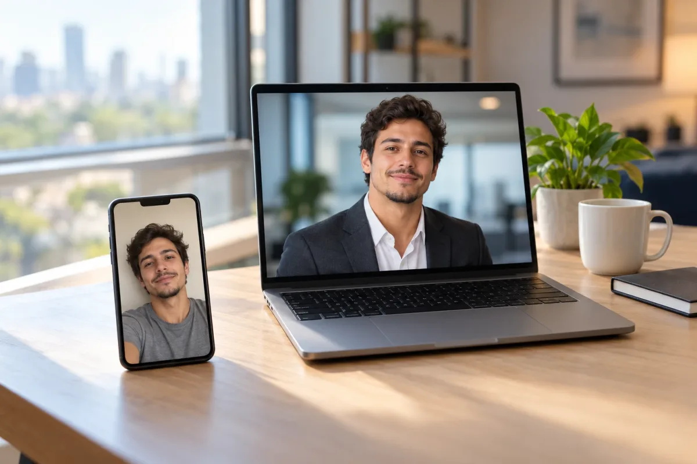
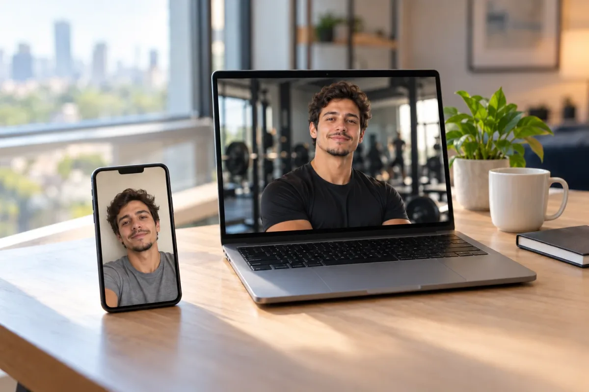
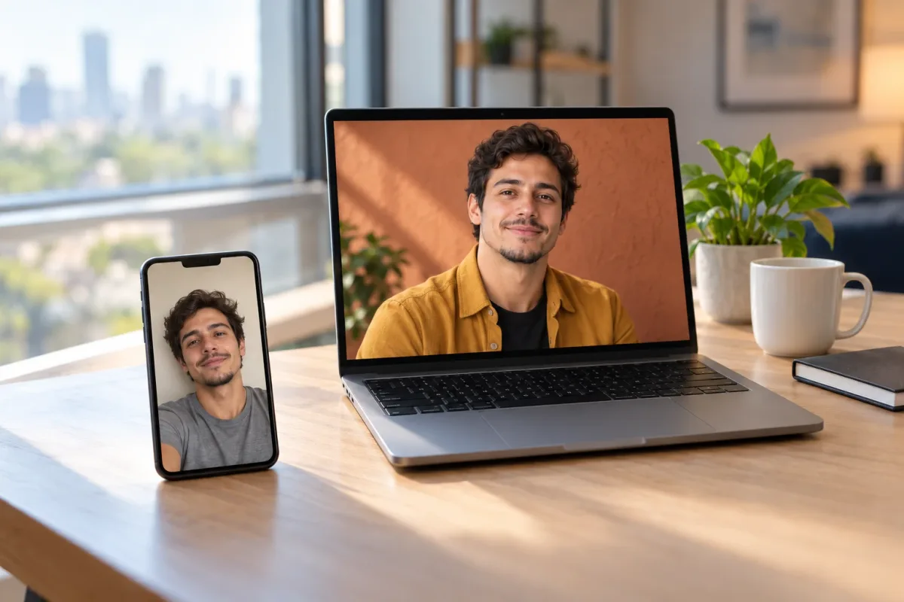

Uma boa foto de perfil abre porta no LinkedIn, no site e no WhatsApp Business, mas nem todo mundo tem um fotógrafo à mão. Um **prompt de foto profissional no ChatGPT** troca o fundo, a roupa e a luz de uma foto sua, e o que muda de uma profissão para outra é justamente o que o prompt precisa dizer. Se você ainda não sabe como funcionam os atalhos de imagem, comece pelos [100 comandos do ChatGPT para imagens](/comandos-do-chatgpt/); o `/proshot` e outros efeitos de retrato estão no guia para [editar foto com comandos prontos](/comandos-chatgpt-editar-fotos/).

Aqui o foco é outro: **10 modelos, um por área**, cada um com roupa, fundo, luz e postura que combinam com a profissão, mais um checklist para a foto não sair com cara de plástico. Mostro **três exemplos, advogado, designer e personal trainer**, gerados no ChatGPT em 26/10/2026 com um personagem criado por IA, não com uma pessoa real; os outros sete prompts **não foram testados** e valem como ponto de partida. Não registrei qual versão do modelo gerou as imagens, e o resultado muda de uma tentativa para outra. Para mudar o enquadramento, veja os [ângulos de câmera com IA](/angulos-de-camera-prompt-ia/).

## Qual IA usar e onde colar o prompt

O caminho principal é o **ChatGPT**, no aplicativo ou no navegador. O **Gemini** também aceita foto e serve de alternativa; se um não agradar, teste o outro. Passo a passo:

1. Escolha uma foto sua nítida, de frente, com o rosto bem iluminado e sem óculos escuros ou boné.
2. Abra o ChatGPT (ou o Gemini) e comece uma conversa nova.
3. Envie a foto: no ChatGPT, pelo clipe de papel; no Gemini, pelo botão "+".
4. Cole o prompt na caixa de texto, junto com a foto, e envie.
5. Compare o resultado com a original e peça ajustes na mesma conversa.

A versão gratuita costuma ter limite diário de imagens, e esse limite muda com o tempo; confira na sua conta.

## Comece pela versão simples

Antes dos prompts por área, teste o mais curto. Se o resultado já servir, nem precisa do resto:

```prompt
Use minha foto como base e deixe-a com aparência de retrato profissional. Mude só o fundo e a luz. Mantenha meu rosto, meus traços e minha expressão como estão.
```

Quando quiser controlar roupa, cenário e postura, use o molde completo: **"use minha foto" + "mude só X" + "mantenha o resto"**. Todos os modelos abaixo seguem esse molde e trazem a mesma trava: preservar o rosto e a textura natural da pele.

## Os 10 modelos por área

Cada prompt fica numa caixa com botão de copiar. Nos três exemplos, o retrato aparece na tela do notebook e a selfie de partida fica no celular, ao lado, para você comparar. Para gerar essas imagens usei versões em inglês e mais detalhadas dos prompts de advogado, designer e personal trainer; os que aparecem abaixo são as versões em português, mais curtas.

| Área | Roupa e fundo | Copiar |
|---|---|---|
| Advogado(a) | Blazer escuro, escritório sóbrio | 📋 Copiar |
| Saúde (médico, dentista) | Jaleco limpo, consultório claro | 📋 Copiar |
| Professor(a) | Casual elegante, sala ou biblioteca | 📋 Copiar |
| Corretor(a) de imóveis | Blazer ou camisa social, sala clara | 📋 Copiar |
| Personal trainer | Roupa esportiva lisa, academia | 📋 Copiar |
| Nutricionista | Roupa clara, cozinha ou consultório | 📋 Copiar |
| Designer ou criativo | Roupa com personalidade, parede colorida | 📋 Copiar |
| Desenvolvedor(a) ou TI | Camisa casual, mesa de trabalho | 📋 Copiar |
| Vendedor(a) ou comercial | Camisa social, escritório moderno | 📋 Copiar |
| Autônomo ou pequeno empresário | Roupa do seu dia a dia, seu local | 📋 Copiar |

### 1. Advogado(a)

Passa seriedade e confiança: roupa sóbria, fundo discreto, expressão firme mas acolhedora.

```prompt
Use minha foto como base e faça um retrato profissional de advogado(a): blazer escuro e camisa clara, fundo de escritório sóbrio e desfocado, luz suave de janela vinda do lado, ombros retos, olhando para a câmera com expressão séria e acolhedora. Mantenha meu rosto, meus traços e a textura natural da pele. Sem logotipos nem texto.
```



Resultado do exemplo: blazer cinza-escuro, camisa branca aberta no colarinho e fundo de escritório desfocado, como pedido. O cabelo cacheado e a barba rala da selfie se mantiveram, e a expressão ficou mais séria do que na selfie.

### 2. Saúde: médico(a) e dentista

Branco limpo e luz uniforme transmitem higiene. Se você divulga a imagem, confira se o seu conselho profissional tem regras para fotos de divulgação.

```prompt
Use minha foto como base e faça um retrato profissional de profissional de saúde: jaleco branco limpo sobre roupa clara, fundo de consultório claro e desfocado, luz uniforme e suave, sorriso discreto e acolhedor. Mantenha meu rosto, meus dentes naturais e a textura da pele. Sem estetoscópio, crachá, logotipo ou texto.
```

### 3. Professor(a)

Pareça próximo, não corporativo.

```prompt
Use minha foto como base e faça um retrato de professor(a): cardigã ou camisa casual elegante, fundo de biblioteca ou sala de aula desfocado, luz natural e quente, sorriso aberto. Mantenha meu rosto, meu cabelo e a textura natural da pele. Sem texto legível ao fundo.
```

### 4. Corretor(a) de imóveis

Cliente quer confiança e simpatia. Evite colocar logotipo de imobiliária, porque a IA costuma errar letras.

```prompt
Use minha foto como base e faça um retrato de corretor(a) de imóveis: blazer ou camisa social, fundo de sala de apartamento clara e desfocada, luz natural de dia, postura confiante e sorriso aberto. Mantenha meu rosto e a textura natural da pele. Sem placas, logotipos ou texto.
```

### 5. Personal trainer

Roupa esportiva lisa e luz com mais contraste. A trava mais importante é não mexer no corpo.

```prompt
Use minha foto como base e faça um retrato de personal trainer: camiseta esportiva lisa, fundo de academia desfocado, luz lateral um pouco mais forte, braços cruzados, expressão motivada. Não altere meu corpo nem meus músculos: mantenha meu rosto, meus braços e a textura natural da pele. Sem logotipos.
```



Resultado do exemplo: camiseta esportiva preta lisa, braços cruzados e uma academia desfocada ao fundo, com luz lateral. Aqui vale comparar o porte do corpo com o da selfie, porque é o ponto em que a trava "não altere meu corpo" mais precisa ser conferida.

### 6. Nutricionista

Cores claras e um toque de natureza passam acolhimento.

```prompt
Use minha foto como base e faça um retrato de nutricionista: roupa clara, fundo de cozinha ou consultório com plantas, desfocado, luz natural suave, sorriso acolhedor. Não altere meu corpo: mantenha meu rosto, meus traços e a textura natural da pele. Sem texto nem logotipos.
```

### 7. Designer ou criativo

Aqui vale mostrar personalidade, e o fundo pode ter cor.

```prompt
Use minha foto como base e faça um retrato de designer: roupa casual com personalidade, fundo de parede lisa em tom terroso ou azul, luz suave com um leve contraluz, postura descontraída, olhar para a câmera. Mantenha meu rosto, meu cabelo e a textura natural da pele. Sem texto.
```



Resultado do exemplo: camisa mostarda sobre camiseta preta, parede terracota e luz suave com um reflexo quente. O rosto, o cabelo e a barba seguem os da selfie, e a postura ficou mais descontraída.

### 8. Desenvolvedor(a) ou TI

Casual e limpo. O alerta é a tela ao fundo: a IA inventa código ilegível, então peça que ela fique apagada.

```prompt
Use minha foto como base e faça um retrato de desenvolvedor(a): camisa casual ou camiseta lisa, fundo de mesa de trabalho com monitor desligado e desfocado, luz neutra, olhar para a câmera, expressão tranquila. Mantenha meu rosto, meus óculos (se eu usar) e a textura natural da pele. Sem texto ou código visível.
```

### 9. Vendedor(a) ou comercial

O objetivo é parecer alguém com quem dá vontade de conversar.

```prompt
Use minha foto como base e faça um retrato de profissional de vendas: camisa social sem gravata ou blazer claro, fundo de escritório moderno e desfocado, luz brilhante e uniforme, postura aberta, sorriso simpático. Mantenha meu rosto e a textura natural da pele. Sem logotipos nem texto.
```

### 10. Autônomo ou pequeno empresário

Mostre você no seu lugar de trabalho; troque o trecho entre colchetes.

```prompt
Use minha foto como base e faça um retrato de pequeno empresário(a): roupa do meu dia a dia de trabalho, fundo do meu local ([oficina, loja, ateliê, salão]) desfocado, luz natural, sorriso confiante. Mantenha meu rosto e a textura natural da pele. Sem placas, logotipos ou texto.
```

## Checklist contra o rosto de plástico

Rosto de plástico é aquele liso demais, simétrico demais, com pele de porcelana. O [guia de prompts da OpenAI](https://developers.openai.com/cookbook/examples/multimodal/image-gen-models-prompting-guide) recomenda pedir textura real (poros, rugas, imperfeições) e evitar palavras de estúdio polido, e traz o pedido "sem glamourização, sem retoque pesado". Por isso os prompts acima mandam manter a textura natural. Mesmo assim, confira, com a original ao lado:

1. **Traços:** nariz, boca, sobrancelhas e formato do rosto são os seus? Pintas e cicatrizes continuam lá?
2. **Pele:** há poros e linhas de expressão, ou tudo virou borrão brilhante?
3. **Olhos:** mesma cor, olhar natural, sem reflexo estranho nem um maior que o outro.
4. **Dentes:** quantidade e tamanho parecem os seus, sem fileira perfeita demais.
5. **Mãos e orelhas:** se aparecerem, conte os dedos e olhe a forma.
6. **Cabelo:** bordas sem recorte, fios soltos naturais.
7. **Detalhes:** botões, óculos, brincos e qualquer texto inventado.
8. **Idade aparente:** você não ficou anos mais jovem nem mais velho.
9. **Teste final:** mostre para alguém que te conhece e pergunte se é você.

## Não ficou como queria? Peça o ajuste

```prompt
Parece outra pessoa. Refaça mantendo exatamente o meu rosto, meus traços e a minha pele como na foto original.
```

```prompt
A pele ficou lisa demais. Refaça com poros e linhas de expressão visíveis, sem retoque pesado.
```

## Uso honesto: ainda precisa parecer você

A IA redesenha o rosto, então a foto final é uma imagem parecida com você, não uma foto sua retocada. Segundo o [Olhar Digital](https://olhardigital.com.br/2025/10/23/internet-e-redes-sociais/ia-no-curriculo-como-deixar-as-fotos-de-perfil-mais-profissionais/), em reportagem de outubro de 2025, o LinkedIn exige que a foto reflita a aparência real do usuário e pode remover imagens que não cumpram a regra. Não consegui abrir a página oficial do LinkedIn na hora, então confira a política atual. A mesma matéria cita um representante do ZipRecruiter dizendo que foto de IA é arriscada, porque imagem malfeita é fácil de reconhecer, e um especialista que defende manter o candidato reconhecível.

Na prática: se alguém não te reconhecer numa entrevista, a foto foi longe demais. Algumas plataformas e empregadores podem exigir foto fiel, e documentos oficiais têm regras próprias para a foto, então use uma foto comum neles. Use só fotos suas, ou de quem autorizou.

## O que esperar

Nenhum resultado é garantido: o mesmo prompt pode dar imagens diferentes a cada tentativa, e a IA pode acrescentar detalhes que você não pediu. Se a primeira não servir, tente de novo ou use outra foto. Para mexer só na luz, veja os [comandos de luz para fotos com IA](/comandos-iluminacao-ia-foto/), e quem vende produto pode usar os [prompts de foto de produto](/prompt-foto-de-produto-chatgpt/).

## Perguntas frequentes

### O ChatGPT consegue fazer uma foto profissional a partir de uma selfie?

Consegue trocar fundo, roupa e luz a partir da sua foto, mas ele redesenha a imagem inteira, inclusive o rosto. Por isso o prompt deve pedir para preservar seus traços, e você precisa comparar o resultado com a foto original antes de usar.

### Posso usar a foto feita por IA no LinkedIn ou no currículo?

Depende da plataforma e do empregador. Segundo o Olhar Digital, o LinkedIn exige que a foto reflita a aparência real do usuário e pode remover imagens que fujam disso. Confira a política atual e use uma foto em que as pessoas ainda reconheçam você.

### Como evitar o rosto de plástico na foto gerada?

Peça pele com textura natural e sem retoque pesado, mande preservar seus traços e confira olhos, dentes e mãos. Se o rosto ficar liso demais ou parecer outra pessoa, peça o ajuste na mesma conversa ou tente de novo com outra foto.

Fontes: [OpenAI Cookbook, guia de prompts para modelos de imagem](https://developers.openai.com/cookbook/examples/multimodal/image-gen-models-prompting-guide) | [Olhar Digital, IA no currículo: como deixar as fotos de perfil mais profissionais (23/10/2025)](https://olhardigital.com.br/2025/10/23/internet-e-redes-sociais/ia-no-curriculo-como-deixar-as-fotos-de-perfil-mais-profissionais/)
