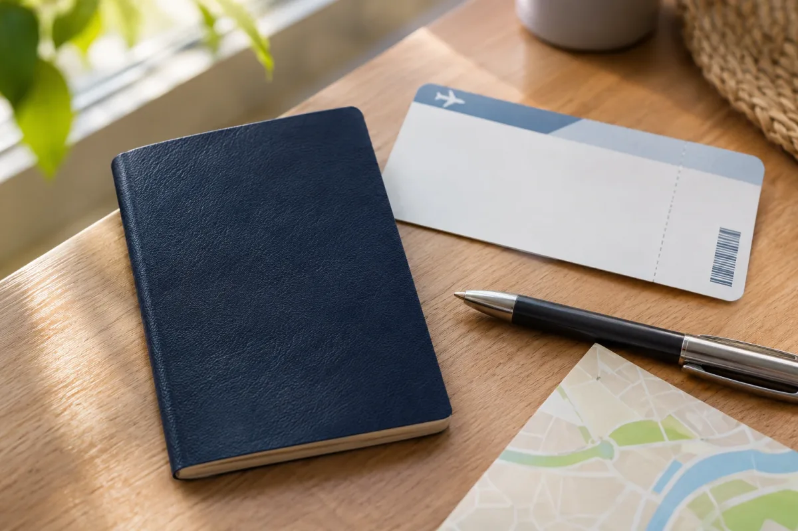

Antes de tudo, um ajuste na pergunta: **brasileiro não pode entrar nos Estados Unidos sem visto**. O Brasil não está no Programa de Isenção de Vistos (Visa Waiver Program), por isso não existe o ESTA para quem viaja com passaporte brasileiro. A embaixada dos EUA no Brasil informa que todos os brasileiros precisam de visto, inclusive quem só faz conexão.

A dúvida de fundo, porém, é ótima: **quanto tempo dá para ficar com o visto de turismo?** É isso que este tira-dúvidas responde, em linguagem simples. E um aviso útil para quem está começando a se planejar: desconfie de sites e perfis que prometem "visto garantido" ou cobram para marcar entrevista. Vale reler o guia para [identificar sites falsos e golpes](/como-identificar-site-falso-promocao-amazon-golpe/) antes de pagar qualquer taxa.

## Por que não existe "entrar sem visto" para brasileiros?

Porque o ESTA, a autorização eletrônica que alguns viajantes usam para ficar até 90 dias sem visto, só vale para cidadãos de países do Visa Waiver Program. O Brasil não está na lista. Então o caminho é pedir o visto de visitante, categoria **B1/B2** (B1 para negócios, B2 para turismo e visita a familiares, normalmente emitidos juntos).

## Qual a diferença entre ESTA e visto?

- **ESTA:** autorização online para cidadãos de países isentos. Não vale para brasileiros.
- **Visto B1/B2:** adesivo no passaporte, concedido pelo consulado depois de entrevista. Permite que você **peça** para entrar. A decisão final é sempre do oficial de imigração no aeroporto.

## Quanto tempo vale o visto de turismo?

Para brasileiros, a tabela de reciprocidade do Departamento de Estado dos EUA lista validade de 120 meses (10 anos) para os vistos B1 e B2. Mas atenção: o que vale é a **data impressa no seu visto**, que pode ser diferente. E, como veremos a seguir, validade do visto não é tempo de permanência.

## Validade do visto é o mesmo que tempo de estadia?

Não, e essa é a confusão mais comum. São duas coisas separadas:

- **Validade do visto:** período em que você pode chegar à fronteira e pedir para entrar (por exemplo, 10 anos).
- **Tempo de permanência:** quanto você pode ficar **em cada viagem**. Isso é definido na entrada e registrado no I-94.

Ter um visto válido por 10 anos não significa poder morar 10 anos nos EUA. Cada entrada tem seu próprio prazo.

## O que é o I-94 e onde vejo meu prazo?

O I-94 é o registro eletrônico de chegada e saída. Nele aparece a classe de admissão (B2, por exemplo) e a data **"Admit Until"** (admitido até), que é o seu limite real. Quem decide essa data é o oficial da CBP (a alfândega e proteção de fronteiras dos EUA) quando você passa pela imigração.

Na prática, a admissão de turistas costuma ser de até seis meses, mas o oficial pode conceder menos, de acordo com o motivo da viagem e o histórico do viajante. Confira sempre a data logo depois de chegar, no site oficial do [I-94 da CBP](https://i94.cbp.dhs.gov/), informando nome, data de nascimento e dados do passaporte. Se a data estiver errada ou muito curta, procure corrigir cedo, porque erros de registro podem ser tratados pela CBP.

## Dá para prorrogar a estadia?

Em certos casos, sim. O pedido é feito ao USCIS com o formulário I-539 e precisa ser enviado **antes** de a data do I-94 vencer. A instrução do formulário sugere enviar com pelo menos 45 dias de antecedência. Você precisa mostrar um motivo válido e que pretende voltar ao Brasil. Não há garantia de aprovação, e há taxas, então consulte a página sobre como [prorrogar a estadia no site do USCIS](https://www.uscis.gov/visit-the-united-states/extend-your-stay) para ver o valor atual.

## E se eu só fizer conexão nos EUA?

Também precisa de visto. Para quem só passa pelo país a caminho de outro destino, existe o visto de trânsito (C-1). Se na escala você pretende sair do aeroporto para passear ou visitar alguém, a categoria correta é a de visitante (B). Antes de comprar a passagem, confirme com a companhia aérea e a embaixada qual visto cobre o seu roteiro.

## Qual o risco de ficar além do prazo (overstay)?

Um dia após a data do I-94 já é permanência irregular. As consequências mais conhecidas são os impedimentos de retorno previstos na lei de imigração americana:

- **Mais de 180 dias e menos de um ano de permanência irregular:** impedimento de **3 anos** para voltar, contado a partir da saída.
- **Mais de um ano:** impedimento de **10 anos**.

Mesmo prazos menores podem trazer dificuldades para futuros vistos, porque o histórico fica registrado. Em caso de imprevisto (doença, voo cancelado, emergência), peça orientação a um advogado de imigração ou aos canais oficiais antes de o prazo vencer. E, se você ficar muito tempo fora do Brasil, lembre-se do título de eleitor: quem está no exterior tem até 30 dias após voltar para [justificar a ausência](/justificar-ausencia-multa-eleitoral-2026/).

## Quanto custa o visto e o que mudou recentemente?

A taxa de solicitação do visto B1/B2 é de US$ 185 por pessoa, cobrada em reais pelo câmbio do dia e sem reembolso em caso de recusa, segundo guias especializados de 2026. Confira o valor exato na tabela de taxas do consulado antes de pagar.

Pontos que valem atenção:

- **Entrevista presencial:** desde 1º de outubro de 2025, o Departamento de Estado exige entrevista na maioria dos pedidos de visto de não imigrante. A dispensa ficou restrita a casos como a renovação de B1/B2 em até 12 meses após o vencimento, quando o visto anterior foi emitido com validade integral, o solicitante nunca teve recusa e pede o visto no país de nacionalidade ou residência (comunicado de 18/09/2025). A embaixada no Brasil descreve critérios parecidos.
- **Taxa de integridade do visto (visa integrity fee):** a lei americana sancionada em 4 de julho de 2025 criou uma cobrança extra de US$ 250 para a maioria dos vistos de não imigrante, incluindo o de turismo. Em 2/11/2026, não encontrei confirmação oficial de que ela já esteja sendo cobrada dos brasileiros nem data de início. Trate o valor como possível custo futuro e confirme no [site do Departamento de Estado](https://travel.state.gov/content/travel/en/us-visas/Visa-Reciprocity-and-Civil-Documents-by-Country/Brazil.html) antes de planejar o orçamento.

## Checklist final para não errar

1. Faça o visto B1/B2 antes de comprar passagem e hospedagem.
2. Use apenas os canais oficiais para agendar e pagar.
3. Ao chegar, confira o I-94 e anote a data "Admit Until".
4. Se precisar de mais tempo, peça a prorrogação **antes** do vencimento.
5. Saia do país dentro do prazo e guarde comprovantes da saída.

## Perguntas frequentes

**Brasileiro pode entrar nos EUA sem visto?** Não. O Brasil não está no Visa Waiver Program, e não há ESTA para brasileiros.

**Quanto tempo posso ficar?** O oficial da CBP define na entrada, e a data aparece no I-94. Costuma ser de até seis meses, mas pode ser menos.

**Posso prorrogar?** Em alguns casos, com o I-539, sempre antes de o prazo vencer.

**O que acontece no overstay?** Pode haver impedimento de 3 ou 10 anos para voltar, dependendo do tempo de permanência irregular.

Fontes: [Departamento de Estado: reciprocidade para o Brasil](https://travel.state.gov/content/travel/en/us-visas/Visa-Reciprocity-and-Civil-Documents-by-Country/Brazil.html) | [Embaixada dos EUA no Brasil: vistos](https://br.usembassy.gov/visas/) | [Embaixada dos EUA no Brasil: visto de não imigrante](https://br.usembassy.gov/non-immigrant-visas-overview/) | [CBP: Visa Waiver Program e ESTA](https://www.cbp.gov/travel/international-visitors/visa-waiver-program) | [CBP: I-94](https://i94.cbp.dhs.gov/) | [USCIS: prorrogar estadia](https://www.uscis.gov/visit-the-united-states/extend-your-stay) | [USCIS: formulário I-539](https://www.uscis.gov/i-539) | [USCIS Policy Manual: permanência irregular](https://uscis.gov/es/node/94263) | [Departamento de Estado: visto de trânsito](https://travel.state.gov/content/travel/en/us-visas/other-visa-categories/transit.html) | [Departamento de Estado: atualização de dispensa de entrevista (18/09/2025)](https://travel.state.gov/content/travel/en/News/visas-news/interview-waiver-update-sept-18-2025.html)
