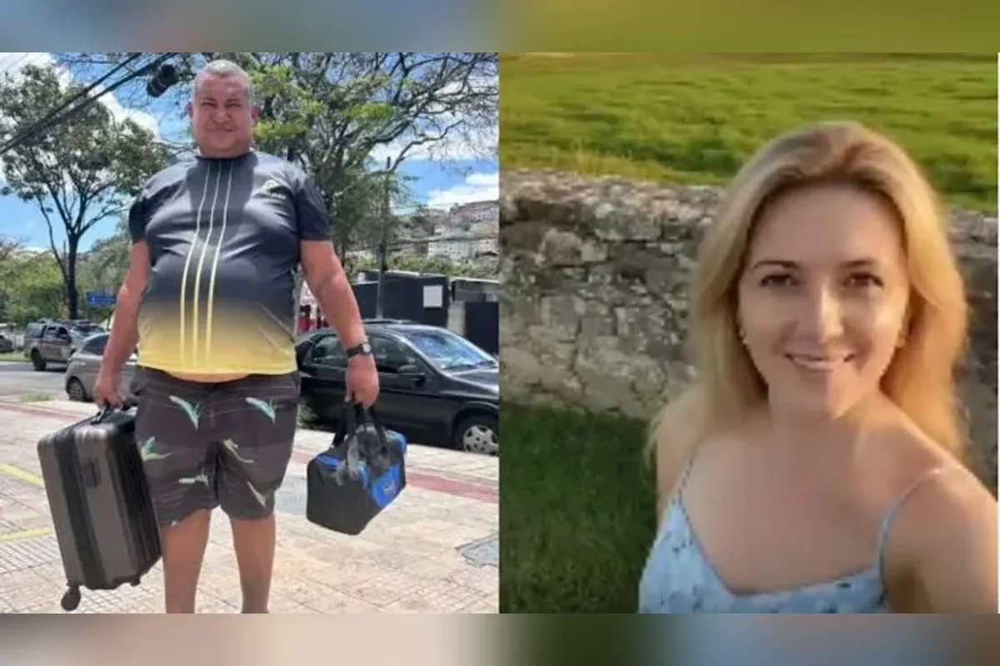

Um pedreiro de 49 anos saiu de Imperatriz, no Maranhão, e atravessou cerca de 2 mil quilômetros de ônibus até Belo Horizonte para encontrar uma mulher que conhecera pelas redes sociais. Ela não existia. O caso, que circulou em portais como [CNN Brasil](https://www.cnnbrasil.com.br/nacional/sudeste/mg/ma-para-mg-pedreiro-viaja-mais-de-2-mil-km-atras-de-mulher-criada-por-ia/) e Metrópoles, expõe de forma bem concreta os **riscos de vídeos criados com IA**: quando a imagem, a voz e o jeito de falar são sintéticos, a confiança que sentimos por uma "pessoa" vira o ponto mais fácil de atacar.

## O que aconteceu com o homem que viajou 2 mil km?



*Foto: o homem ao chegar a Belo Horizonte (esq.) e imagem da personagem criada com IA (dir.). Fonte: reprodução de reportagens da CNN Brasil e do Metrópoles, outubro de 2026.*

Segundo os relatos, ele acompanhava o perfil de uma personagem que se apresentava como Jéssica, dona de uma fazenda em Minas Gerais, com mais de 300 mil seguidores. Nos vídeos, ela dizia procurar um homem para morar com ela. Ele teria passado a interagir com o perfil depois da morte da mãe, em um período de solidão, e viajou na expectativa de recomeçar a vida.

Ao chegar a Belo Horizonte, no domingo (11), não encontrou ninguém. Sem dinheiro para voltar, procurou o serviço de acolhimento a migrantes da prefeitura, que lhe deu orientação, alimentação e a passagem de volta.

Alguns pontos vale registrar com cuidado:

- A Polícia Civil de Minas Gerais informou não ter registro de ocorrência e disse que criar personagens com IA não é, por si só, crime. Dependendo das circunstâncias, porém, pode haver estelionato.
- Os relatos divergem em detalhes, como a cidade de destino da passagem. Por isso, tratamos aqui só do que é comum às reportagens.
- Segundo o Metrópoles, o responsável pelo perfil publicou um vídeo dizendo que a personagem era feita com IA e que o objetivo era engajamento para vendas, e depois apagou a conta.

Não há motivo para ridicularizar o homem. Ele foi enganado por um formato desenhado para parecer próximo, e isso pode acontecer com qualquer pessoa em um momento de fragilidade.

## Por que esses perfis funcionam tão bem?

Personagens sintéticos têm três vantagens sobre uma pessoa real. Nunca erram o enquadramento, nunca cansam e podem ser ajustados para dizer exatamente o que o público quer ouvir. Quando o assunto é carência, a promessa de afeto e de uma vida nova é um gancho poderoso.

Isso não é novidade em si. Influenciadoras virtuais assumidas, como a Lu do Magalu, existem há anos, e o público sabe que são personagens. O problema aparece quando o perfil **não deixa claro** que é artificial, ou quando responde mensagens como se fosse gente de verdade.

## Quais são os principais riscos de vídeos criados com IA?

O caso do pedreiro é emocional, mas o mesmo tipo de tecnologia aparece em ameaças mais caras:

- **Golpe afetivo e de investimento:** o perfil cria vínculo e, depois, pede dinheiro, "ajuda" ou convence a investir.
- **Fraude corporativa:** em 2024, a empresa britânica Arup confirmou que um funcionário em Hong Kong foi levado a fazer transferências de cerca de US$ 25 milhões após uma videoconferência com participantes falsos, entre eles uma réplica digital do diretor financeiro, conforme [noticiado na época](https://invezz.com/pt/noticias/2024/05/17/deepfake-a-empresa-britanica-arup-e-vitima-de-um-golpe-de-us-25-milhoes-como-voce-pode-se-proteger/).
- **Desinformação eleitoral:** no Brasil, o TSE fixou em setembro de 2026 uma tese sobre deepfake nas eleições e já havia regulado o uso de conteúdo sintético na propaganda, com exigência de rotulagem. Veja o resumo no [site do TSE](https://www.tse.jus.br/comunicacao/noticias/2026/Setembro/tse-fixa-tese-sobre-deepfake-e-delimita-regra-para-as-eleicoes-2026).
- **Uso indevido da sua imagem:** uma selfie publicada pode alimentar um vídeo falso. Até brincadeiras como a [trend dos anos 80 com IA](/trend-anos-80-ia-foto-prompt/) lembram que o rosto vira material de entrada.

## As plataformas obrigam a avisar que é IA?

Em geral, TikTok, YouTube e Meta pedem que criadores sinalizem conteúdo realista feito ou alterado com IA, e usam padrões técnicos de identificação como os Content Credentials (C2PA) para rotular automaticamente parte desse material. Na prática, a rotulagem depende muito de quem publica, e perfis mal-intencionados simplesmente não declaram. Confira sempre a política atual de cada plataforma, porque as regras mudam com frequência.

Existem também esforços para marcar o conteúdo na origem, como o [textGrain, da OpenAI, que insere marca-d'água invisível em textos](/marca-dagua-invisivel-textos-ia-textgrain/). Mas nenhuma marcação cobre tudo. A checagem final ainda é sua.

## Como saber se um vídeo ou perfil é feito com IA?


*Imagem gerada por IA para o TechOnPlay: nenhuma das quatro mulheres existe. O prompt usado está na seção "Como essas imagens de influenciadoras foram criadas?"[^1]*

Nenhum sinal sozinho prova nada, e os geradores melhoram a cada mês. O que funciona é somar indícios:

1. **Rosto e mãos com detalhes estranhos:** dentes, brincos, cabelo e dedos que mudam de um quadro para outro.
2. **Voz e boca levemente fora de sincronia**, com entonação muito uniforme.
3. **Fundo que "derrete" ou se repete**, objetos que somem, texto ilegível ao fundo.
4. **Perfil sem rastro fora da própria conta:** sem amigos reais, sem marcações de terceiros, sem aparições em outros lugares.
5. **Vídeos longos e sempre perfeitos**, com a mesma luz e o mesmo enquadramento em cenários diferentes.
6. **Respostas rápidas demais, genéricas, e que evitam videochamada ao vivo** ou qualquer encontro verificável.
7. **Pressa e promessa grande:** afeto intenso em poucos dias, fazenda, herança, investimento garantido.

Uma busca reversa pela foto (no Google Imagens ou no Google Lens) também ajuda a ver se aquele rosto aparece em outros contextos ou com outros nomes.

## O que fazer se você caiu ou desconfia?

- **Pare a conversa** e não envie dinheiro, documentos, códigos ou fotos íntimas.
- **Peça uma videochamada ao vivo**, com um gesto simples e imprevisível, como virar de lado ou segurar um objeto. Quem usa avatar costuma recusar ou dar desculpa.
- **Conte para alguém de confiança** antes de decidir qualquer viagem ou transferência.
- **Guarde provas**: capturas de tela, links, números de conta e conversas.
- **Denuncie o perfil** na própria plataforma e, se houve prejuízo, registre boletim de ocorrência. Para golpes envolvendo links e páginas falsas, veja também como [identificar sites falsos de promoção](/como-identificar-site-falso-promocao-amazon-golpe/).

Se quiser uma segunda opinião antes de compartilhar um vídeo suspeito, peça a um assistente de IA, sabendo que ele não substitui a checagem em fontes confiáveis:

```prompt
Vou colar a descrição de um vídeo e de um perfil de rede social. Liste sinais de que o conteúdo pode ter sido gerado ou alterado por IA, aponte o que eu devo conferir fora da plataforma e diga o que é só indício, sem afirmar que é falso.
```

## Como essas imagens de influenciadoras foram criadas?

Para mostrar como é fácil montar um "perfil" convincente, geramos duas colagens com IA, sem nenhuma pessoa real. A primeira, usada no meio do texto, nasceu deste prompt, em inglês:

```prompt
Create a horizontal 3:2 ultra-realistic image: a 2x2 collage of four candid-style smartphone photos separated by thin white grid lines, in the look of an online loungewear brand's Instagram content. Each photo shows a different adult woman (ages 25–32) modeling tasteful, everyday cotton or lace loungewear sets, in natural catalog poses. Fashion e-commerce style, elegant and non-explicit. 1) brunette with wavy hair, beige set, bright bedroom with soft window light; 2) freckled redhead, white set, close-up selfie angle; 3) curly blonde with round glasses, sage-green set, sitting on a bed with white linen sheets; 4) Black woman with long straight hair, burgundy set, mirror selfie holding a phone. Photorealism: modern smartphone camera look (24–26mm, f/1.8), natural skin texture with visible pores and freckles, realistic hands with correct fingers, natural eye catchlights, true-to-life color grading, light film grain. Each woman has a distinct face, body type and skin tone. No logos, no text, no watermarks.
```

A capa deste artigo veio de uma segunda etapa: a primeira imagem foi enviada de volta ao gerador com um pedido de edição, que mantém os mesmos rostos e troca apenas roupa e cenário:

```prompt
Use the uploaded image as reference. Keep the exact same 2x2 collage layout, the same four women (identical faces, hair, skin tones, freckles, glasses and body types), the same poses and the same thin white grid lines. Change only the outfits and the locations: place each woman on a beach, wearing a stylish, tasteful bikini or swimsuit, as if photographed for a beachwear brand's Instagram. Adult women, elegant and non-explicit. Keep the same ultra-realistic smartphone look and make sure the faces stay recognizable as the same four women. No logos, no text, no watermarks, no captions, no extra people.
```

O ponto não é ensinar a enganar ninguém: é mostrar que dois pedidos de texto bastam para criar a mesma "pessoa" em vários cenários, e é assim que perfis falsos ganham aparência de rotina real. Quem usa isso para criar personagens deveria avisar, no próprio perfil, que são imagens sintéticas.

## O que esse caso deixa de lição?

A tecnologia não é o único problema. Um vídeo bonito e uma promessa de companhia explicam por que tanta gente confia sem checar. Criar personagens com IA é legal e pode ser criativo, mas apresentar essa personagem como uma pessoa real, para ganhar atenção ou dinheiro, é onde mora o risco. Desconfie do que parece bom demais, verifique fora da tela e, na dúvida, converse com alguém antes de pegar a estrada.

[^1]: Imagem gerada por inteligência artificial, sem pessoas reais, a partir do primeiro prompt acima. Qualquer semelhança com pessoas reais é coincidência. A capa do artigo foi gerada pelo segundo prompt, a partir desta mesma imagem.
