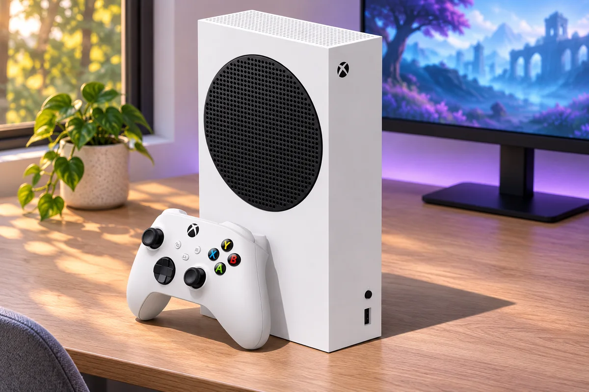
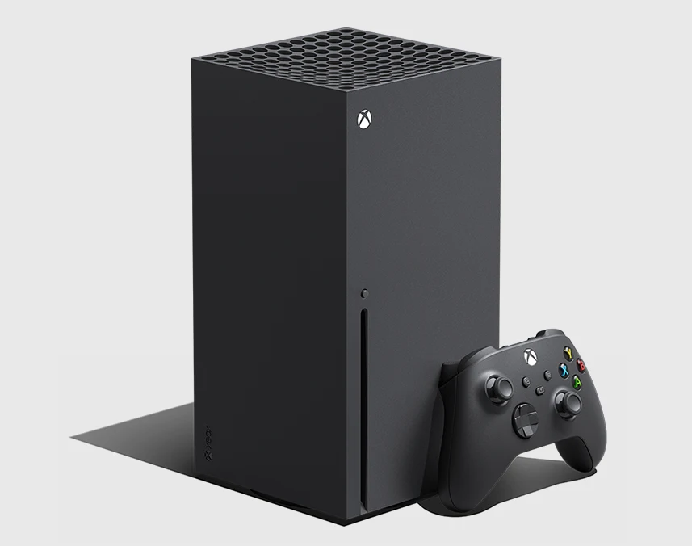
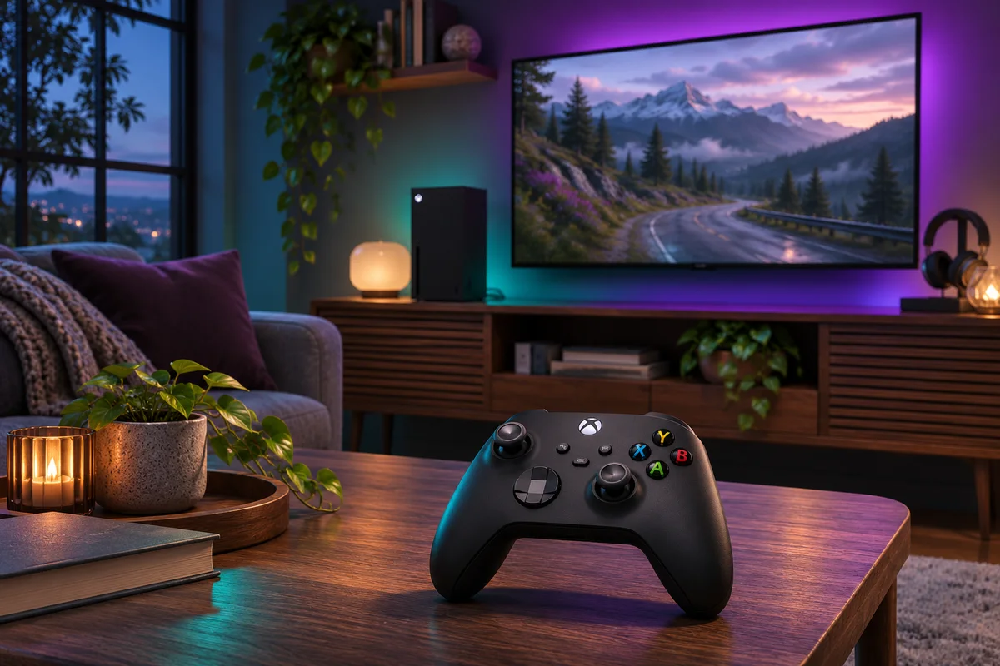

O **Xbox Series S** é a melhor escolha para quem joga em Full HD, compra jogos digitais e encontra uma boa oferta. O **Xbox Series X** faz mais sentido para quem tem uma TV 4K ou já investiu em jogos em disco. O preço pesa no Brasil: em novembro de 2026, uma pesquisa do Procon-ES encontrou uma diferença de **R$ 1.752,24** entre ofertas à vista para o mesmo Series S de 512 GB.

Os dois modelos rodam GTA 6. Se esse é o jogo que motivou a compra, veja [como GTA 6 roda nos consoles](/gta-6-60-fps-ps5-pro/) antes de decidir quanto pagar. Para comparar o Xbox com outros aparelhos na mesma faixa, confira também o nosso [review do PlayStation 5 com preços no Brasil](/playstation-5-preco-review/).

*Análise baseada em fichas técnicas oficiais e preços do varejo, sem testes práticos próprios. As imagens são ilustrações geradas por IA.*

## O que muda entre o Xbox Series X e o Series S?

| Característica | Xbox Series S | Xbox Series X |
| --- | --- | --- |
| Resolução de referência | 1440p | 4K |
| Taxa de quadros | Até 120 fps em jogos compatíveis | Até 120 fps em jogos compatíveis |
| SSD interno | 512 GB ou 1 TB | 1 TB nas versões com leitor ou digital |
| Mídia física | Somente jogos digitais | Versão com Blu-ray 4K e versão digital |
| Recursos em comum | Quick Resume e Game Pass | Quick Resume e Game Pass |

A resolução e a taxa de quadros dependem de cada jogo e do modo gráfico escolhido. Para jogar a 120 fps, a TV ou o monitor também precisa aceitar 120 Hz. Se você vai trocar de TV junto com o console, a [análise da TCL C6K](/tcl-c6k-vale-a-pena/) explica como conferir a taxa do painel e as entradas HDMI.

## Quando vale comprar o Xbox Series S?

*O Series S de 512 GB é compacto e aceita jogos digitais.*

O Series S é uma boa compra para quem joga em **Full HD** e quer gastar menos no console. Ele roda títulos da geração Series X|S e ocupa pouco espaço. A ficha da Microsoft usa 1440p como referência. Em jogos mais exigentes, a resolução e os ajustes gráficos podem variar.

A escolha entre **512 GB e 1 TB** importa para quem alterna entre jogos grandes. Se você termina uma campanha antes de instalar a próxima, o modelo menor pode bastar. Se costuma deixar um jogo de futebol, um de corrida e dois mundos abertos instalados, o SSD de 1 TB dá mais folga. Parte da capacidade anunciada fica reservada para o sistema. A Rockstar informa que a instalação de GTA 6 pode exigir até 212 GB livres, dependendo do aparelho.

## Quando vale pagar mais pelo Xbox Series X?

*O Series X Carbon Black de 1 TB tem leitor de discos.*

O Series X oferece mais potência gráfica para jogar em **4K**. A vantagem costuma importar mais para quem usa uma tela grande e joga títulos exigentes. Mesmo em Full HD, a diferença pode aparecer em jogos que oferecem modos gráficos distintos para cada modelo.

O **Series X com leitor** também é a escolha da linha para quem já tem discos de Xbox compatíveis. Você pode comprar jogos físicos usados, emprestar ou revender os que terminou. Se a sua coleção é digital, compare as duas versões de 1 TB. O Series X branco de 1 TB é digital, então confira a descrição do anúncio antes de comprar.

## Quick Resume, Game Pass e expansão do SSD

*O Quick Resume guarda o progresso da sessão de jogos compatíveis para você retomar depois.*

O **Quick Resume** está nos dois consoles. Dá para alternar entre jogos compatíveis e voltar de onde você parou. É um recurso útil para quem joga em sessões curtas ou divide o console em casa. Títulos que dependem de conexão podem pedir que você se reconecte ao voltar.

O **Game Pass** é uma assinatura à parte. Para quem gosta de experimentar jogos, vale olhar o catálogo do plano disponível no Brasil. Se você costuma passar meses nos mesmos títulos, compare o custo anual da assinatura com o preço de comprar os jogos que realmente quer.

Os dois consoles aceitam placa de expansão compatível. Se você já prevê instalar muitos jogos, faça a conta do Series S de 512 GB mais a placa antes de decidir. O modelo de 1 TB pode resolver o problema de uma vez e ainda deixar o slot de expansão livre.

## Quanto custa um Xbox Series no Brasil?

| Modelo | Preço registrado | Fonte e data |
| --- | --- | --- |
| Series S de 512 GB | R$ 3.447,75 a R$ 5.199,99 à vista | Pesquisa do Procon-ES, de 5 a 10 de novembro de 2026 |
| Series X de 1 TB com leitor | R$ 7.599,05 | Oferta do Mercado Livre registrada pelo Descontoo em 19 de novembro de 2026 |

São referências de novembro, coletadas em datas e lojas diferentes. Antes de fechar a compra, confira o preço no seu CEP, quem vende o console e quem atende a garantia.

## Veredito

**Para jogar em Full HD, o Series S perto do menor preço pesquisado é a compra mais equilibrada.** Pegue o de 512 GB se você instala poucos jogos por vez. Compare com o de 1 TB se já sabe que vai manter uma biblioteca grande no SSD.

**Para jogar em 4K ou aproveitar discos, o Series X com leitor é o melhor Xbox para o seu perfil.** Aos R$ 7.599,05 da oferta registrada, a diferença é grande o bastante para esperar um preço melhor se a compra puder esperar.

## Fontes consultadas

- [Xbox Brasil, comparativo entre Series X e Series S](https://www.xbox.com/pt-BR/consoles/compare)
- [Xbox Brasil, catálogo e planos do Game Pass](https://www.xbox.com/pt-BR/xbox-game-pass)
- [Xbox Wire, ajustes do Quick Resume](https://news.xbox.com/en-us/2026/04/30/april-xbox-update-2026/)
- [Rockstar Games, requisitos de instalação de GTA 6](https://support.rockstargames.com/articles/M6h7B5fJZMwG1dnzQkt4Z/grand-theft-auto-vi-installation-requirements)
- [Procon-ES, pesquisa de preços de novembro de 2026](https://procon.es.gov.br/media/pesquisa-de-precos-da-black-friday-2026.pdf?v=1794948604639)
- [Descontoo, preço do Xbox Series X de 1 TB](https://descontoo.com.br/produto/console-xbox-series-x-1tb-standard-mlb37335939)
