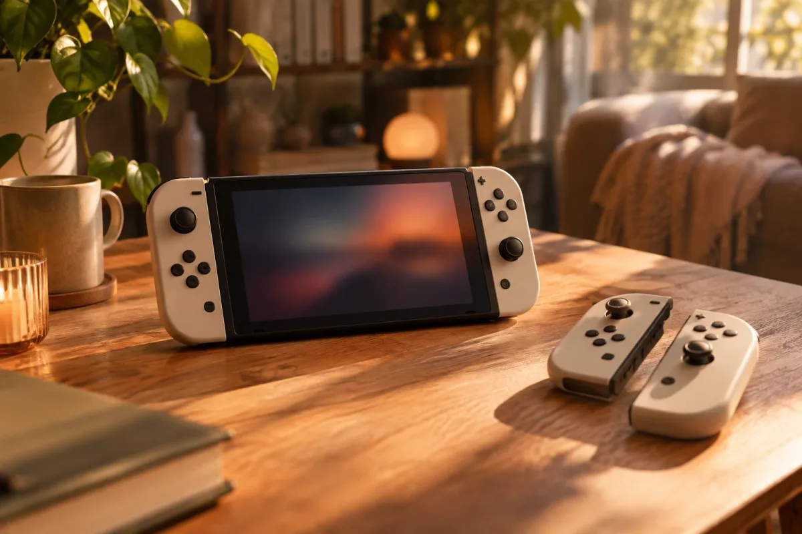

O remake de **The Legend of Zelda: Ocarina of Time** chega amanhã, **5 de novembro de 2026**, e só para o **Nintendo Switch 2**. A dúvida de quem está de olho no jogo é simples: vale o dinheiro? Este texto reúne o que já foi confirmado (preço, requisitos, dublagem) e ajuda você a decidir, sem spoilers.

Se você ainda nem tem o console, comece pelo guia [Nintendo Switch 2 vale a pena?](/nintendo-switch-2-vale-a-pena/), porque o remake não roda no modelo antigo.

## Em que pé está o lançamento

A Nintendo anunciou o remake no Nintendo Direct de **9 de junho de 2026**, e a data de 5 de novembro apareceu em trailers e reportagens logo depois. Em 8 de setembro, um Direct especial pelos **40 anos da série Zelda** mostrou mais cenas do jogo e abriu as pré-vendas no Brasil.

Neste texto, o que vem de reportagens e não da página oficial está indicado. Os dados foram conferidos em 4 de novembro de 2026.

## Ficha rápida: o que você precisa saber

| 🎯 Pergunta | ✅ Resposta |
| --- | --- |
| Data de lançamento | 5 de novembro de 2026 |
| Plataforma | Exclusivo do Nintendo Switch 2 |
| Roda no Switch 1? | Não |
| Preço digital no Brasil | R$ 329,90 (segundo o jornal O Povo) |
| Preço da mídia física | R$ 439,90 (idem) |
| Espaço no console | Cerca de 27 GB (estimativa) |
| Dublagem em português | Sim, completa, segundo a Nintendo |

## Preço no Brasil: digital ou física?

A reportagem do jornal O Povo, de 11 de outubro de 2026, traz os dois valores: **R$ 329,90 na versão digital**, vendida na loja online da Nintendo, e **R$ 439,90 na física**. A edição especial com capa metalizada teria o mesmo preço da capa comum, mas a mesma matéria diz que o estoque dela esgotou em parte das lojas e que alguns varejistas limitam a compra por CPF.

Confirme o valor final na loja antes de pagar. Preço de varejo muda, e promoções de pré-venda não são a regra.

## Precisa de Switch 2? E o Switch 1?

Precisa. A página brasileira da Nintendo lista o jogo como exclusivo do Switch 2, e não há versão anunciada para o modelo original. Reportagens também citam que o remake usa o microfone e o giroscópio do novo console, recursos que o Switch 1 não tem do mesmo jeito.

Quem só tem o Switch original ainda pode jogar a versão clássica de 1998 pelo app Nintendo 64, que faz parte do plano Nintendo Switch Online + Pacote de Expansão, pago à parte.

## Espaço necessário e dublagem em português

O download deve ocupar cerca de **27 GB**, de acordo com a [My Nintendo News](https://mynintendonews.com/2026/09/09/zelda-ocarina-of-time-for-nintendo-switch-2-file-size-will-be-around-27gb/) (09/09/2026), que se baseou na ficha divulgada pela Nintendo. Como a própria ficha avisa que o tamanho pode mudar, trate o número como estimativa. O Switch 2 tem 256 GB internos, então cabe, mas quem já enche o armazenamento pode precisar apagar algo.

Sobre a voz: a Nintendo confirmou **dublagem completa em português do Brasil**, segundo o [Critical Hits](https://criticalhits.com.br/games/remake-de-zelda-ocarina-of-time-tera-dublagem-em-portugues-do-brasil-confira-o-video/) (08/09/2026). Antes disso, só o texto em português estava garantido. A reportagem cita parte do elenco, como Flávia Narciso (Navi) e Bianca Lua (Zelda e Sheik). O Link continua como protagonista silencioso. Não confirmei se é a primeira dublagem brasileira da série, então deixo essa informação de fora.

## O que mudou em relação ao original de 1998

O Ocarina of Time original saiu em 1998 para o Nintendo 64 e virou referência dos jogos de aventura. Em 2011 ganhou uma versão para o Nintendo 3DS, o Ocarina of Time 3D, que melhorou gráficos e controles, mas manteve a estrutura do clássico.

O remake do Switch 2 vai além, segundo o que foi mostrado até agora:

- **Visual refeito do zero**, e não apenas uma versão com resolução maior.
- **Movimento e câmera reformulados**, para ficar mais próximo dos jogos modernos.
- **Cenas dubladas e diálogos ampliados.**
- **Trilha sinfônica.**
- **Ocarina com microfone:** as melodias podem ser tocadas pelos botões ou cantadas, assobiadas ou tocadas num instrumento perto do microfone. Os controles tradicionais continuam disponíveis.

Em resumo: o 3D foi uma atualização do jogo antigo, e este é uma reconstrução. A história e o desenho geral do mundo seguem o original, sem entrar em spoiler.

## E a nota no Metacritic?

Segundo reportagens brasileiras de 3 e 4 de novembro de 2026, como as do Quero Bolsa, do Gamevicio e do GeekDama, o remake estreou com **nota 96 no Metacritic**, com cerca de 80 análises e aprovação quase unânime, o que o coloca no topo do ranking de 2026 até aqui. A página oficial do Metacritic não abriu na minha consulta, então o número vem dessas reportagens. **Confirme a nota atual na página do jogo**, porque ela muda conforme novas análises entram. Como referência, o original de 1998 tem nota 99 no site.

## Vale a pena comprar?

| 🎮 Seu perfil | 💡 Dica |
| --- | --- |
| Tem Switch 2 e gosta de Zelda | Vale: é o jogo feito para esse console |
| Nunca jogou o clássico | Boa porta de entrada, com dublagem em português |
| Joga só no Switch 1 | Não roda: use o app Nintendo 64 ou espere uma promoção do Switch 2 |
| Está em dúvida pelo preço | Espere as análises e compare com a versão digital, mais barata |
| Prefere jogos baratos | Veja a lista de [jogos indie na Steam por menos de R$ 5](/steam-jogos-indie-menos-de-5-reais/) |

Se você é fã da série, o remake de aniversário de 40 anos é uma compra fácil de justificar. Se está só curioso, o melhor caminho é ler as primeiras análises depois do embargo e decidir com calma.

## Onde comprar

A versão digital é vendida na loja online da Nintendo, no próprio Switch 2. A física está em varejistas selecionados no Brasil, mas parte do estoque da edição especial já esgotou. Compare o preço e a política de devolução antes de fechar. A [reportagem do O Povo](https://www.opovo.com.br/vidaearte/2026/10/11/edicao-fisica-especial-de-zelda-esgota-estoques-no-brasil.html) mostra o cenário dos estoques.

Fontes: [Game Over Drive, 12/09/2026](https://gameoverdrive.com.br/ocarina-of-time-remake-switch-1/) | [Game Over Drive, 08/09/2026](https://gameoverdrive.com.br/ocarina-of-time-remake-data-preco-edicoes/) | [MobileSyrup, 09/06/2026](https://mobilesyrup.com/2026/06/09/nintendo-switch-2-zelda-ocarina-of-time-remake/) | [Engadget](https://engadget.com/2252620/switch-2-remake-of-legend-of-zelda-ocarina-of-time-arrives-november-5) | [Notebookcheck](https://www.notebookcheck.net/Metacritic-reveals-Zelda-Ocarina-of-Time-review-embargo-as-release-date-approaches.1438321.0.html)
